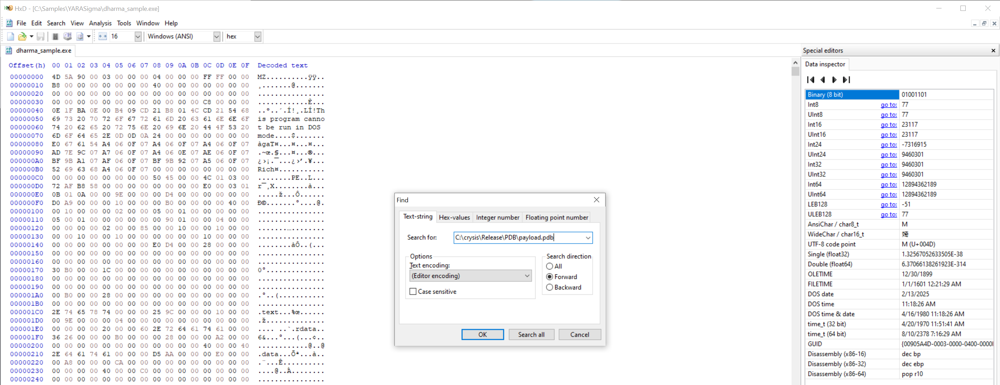
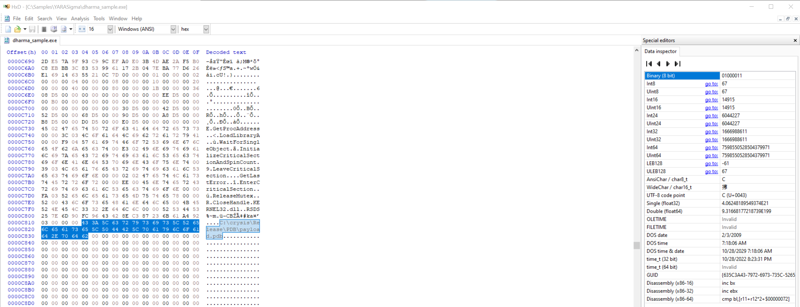
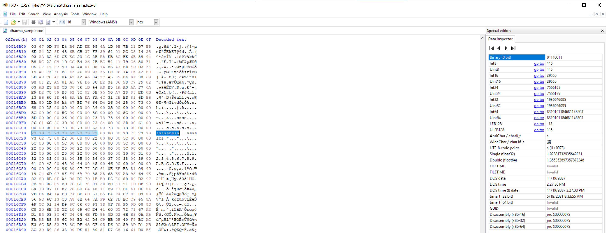
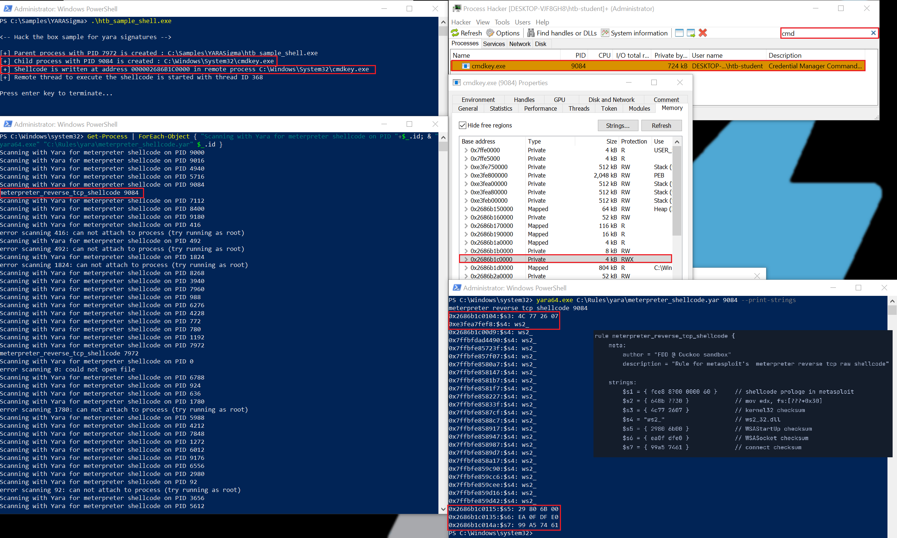
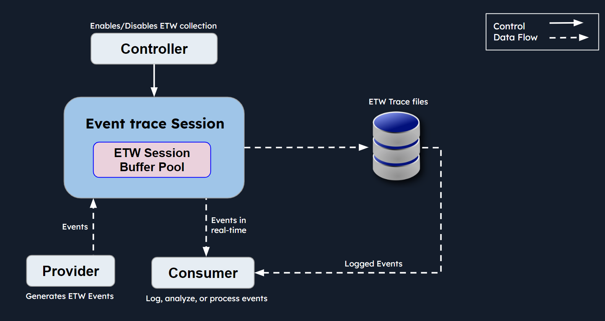

# Hunting Evil with YARA (Windows Edition) (Săn lùng mối đe doạ bằng YARA – phiên bản Windows)

Trong section này, ta sẽ tìm hiểu cách dùng YARA trên hệ thống Windows để nhận diện mối đe doạ cả trên ổ đĩa lẫn trong bộ nhớ.

<div class="card bg-light">
    <div class="card-body">
				 <p class="mb-0">Bây giờ hãy kéo xuống cuối section này và bấm vào "Click here to spawn the target system!". Sau đó, RDP vào Target IP bằng thông tin đăng nhập được cung cấp. Phần lớn các thao tác/lệnh được trình bày từ đây cho tới cuối section này đều có thể làm lại bên trong target, giúp nắm vững hơn các chủ đề được trình bày. </p>
    </div>
</div>

## Săn tìm file thực thi độc hại trên ổ đĩa bằng YARA 

Như đã thấy ở section trước, YARA là một vũ khí lợi hại trong kho công cụ của dân an ninh mạng để phát hiện và săn tìm (hunting) file thực thi độc hại trên ổ đĩa. Với các YARA rule tự viết hoặc các rule có sẵn, ta có thể xác định chính xác các file đáng ngờ hoặc có khả năng độc hại dựa trên các pattern, đặc điểm hoặc hành vi riêng biệt. 

Ta sẽ dùng một sample đã phân tích trước đó tên là `dharma_sample.exe`, nằm trong thư mục `C:\Samples\YARASigma` của target trong section này.

Trước tiên, ta sẽ xem xét malware sample này trong một hex editor (`HxD`, nằm tại `C:\Program Files\HxD`) để tìm chuỗi đã phát hiện trước đó là `C:\crysis\Release\PDB\payload.pdb`. 





Nếu cuộn gần xuống cuối, ta sẽ thấy thêm một chuỗi có vẻ cũng là duy nhất: `sssssbsss`.



Tiếp theo, ta sẽ viết một rule dựa trên các pattern này, rồi dùng tiện ích YARA để rà soát filesystem tìm các file thực thi tương tự.

---

**Lưu ý**: Trên máy Linux, có thể dùng tiện ích `hexdump` để tìm các hex byte nói trên như sau.

```shell-session
remnux@remnux:~$ hexdump dharma_sample.exe -C | grep crysis -n3
3140-0000c7e0  52 00 43 6c 6f 73 65 48  61 6e 64 6c 65 00 4b 45  |R.CloseHandle.KE|
3141-0000c7f0  52 4e 45 4c 33 32 2e 64  6c 6c 00 00 52 53 44 53  |RNEL32.dll..RSDS|
3142-0000c800  25 7e 6d 90 fc 96 43 42  8e c3 87 23 6b 61 a4 92  |%~m...CB...#ka..|
3143:0000c810  03 00 00 00 43 3a 5c 63  72 79 73 69 73 5c 52 65  |....C:\crysis\Re|
3144-0000c820  6c 65 61 73 65 5c 50 44  42 5c 70 61 79 6c 6f 61  |lease\PDB\payloa|
3145-0000c830  64 2e 70 64 62 00 00 00  00 00 00 00 00 00 00 00  |d.pdb...........|
3146-0000c840  00 00 00 00 00 00 00 00  00 00 00 00 00 00 00 00  |................|
```

```shell-session
remnux@remnux:~$ hexdump dharma_sample.exe -C | grep sssssbsss -n3
5738-00016be0  3d 00 00 00 26 00 00 00  73 73 73 64 00 00 00 00  |=...&...sssd....|
5739-00016bf0  26 61 6c 6c 3d 00 00 00  73 64 00 00 2d 00 61 00  |&all=...sd..-.a.|
5740-00016c00  00 00 00 00 73 00 73 00  62 00 73 00 73 00 00 00  |....s.s.b.s.s...|
5741:00016c10  73 73 73 73 73 62 73 73  73 00 00 00 73 73 73 73  |sssssbsss...ssss|
5742-00016c20  73 62 73 00 22 00 00 00  22 00 00 00 5c 00 00 00  |sbs."..."...\...|
5743-00016c30  5c 00 00 00 5c 00 00 00  5c 00 00 00 5c 00 00 00  |\...\...\...\...|
5744-00016c40  22 00 00 00 20 00 22 00  00 00 00 00 5c 00 00 00  |"... .".....\...|
```

---

Hãy đưa toàn bộ các hex byte đã xác định vào một rule, giúp ta phát hiện chuỗi này trong bất kỳ file thực thi nào trên ổ đĩa.

```yara
rule ransomware_dharma {

    meta:
        author = "Madhukar Raina"
        version = "1.0"
        description = "Simple rule to detect strings from Dharma ransomware"
        reference = "https://www.virustotal.com/gui/file/bff6a1000a86f8edf3673d576786ec75b80bed0c458a8ca0bd52d12b74099071/behavior"

    strings:
        $string_pdb = {  433A5C6372797369735C52656C656173655C5044425C7061796C6F61642E706462 }
        $string_ssss = { 73 73 73 73 73 62 73 73 73 }

        condition: all of them
}
```

Rule này (`dharma_ransomware.yar`) có trong thư mục `C:\Rules\yara` của target trong section này.

Chạy file thực thi YARA với rule này, ta xem nó có chỉ ra các sample tương tự khác trên ổ đĩa hay không.

```powershell-session
PS C:\Users\htb-student> yara64.exe -s C:\Rules\yara\dharma_ransomware.yar C:\Samples\YARASigma\ -r 2>null
ransomware_dharma C:\Samples\YARASigma\\dharma_sample.exe
0xc814:$string_pdb: 43 3A 5C 63 72 79 73 69 73 5C 52 65 6C 65 61 73 65 5C 50 44 42 5C 70 61 79 6C 6F 61 64 2E 70 64 62
0x16c10:$string_ssss: 73 73 73 73 73 62 73 73 73
ransomware_dharma C:\Samples\YARASigma\\check_updates.exe
0xc814:$string_pdb: 43 3A 5C 63 72 79 73 69 73 5C 52 65 6C 65 61 73 65 5C 50 44 42 5C 70 61 79 6C 6F 61 64 2E 70 64 62
0x16c10:$string_ssss: 73 73 73 73 73 62 73 73 73
ransomware_dharma C:\Samples\YARASigma\\microsoft.com
0xc814:$string_pdb: 43 3A 5C 63 72 79 73 69 73 5C 52 65 6C 65 61 73 65 5C 50 44 42 5C 70 61 79 6C 6F 61 64 2E 70 64 62
0x16c10:$string_ssss: 73 73 73 73 73 62 73 73 73
ransomware_dharma C:\Samples\YARASigma\\KB5027505.exe
0xc814:$string_pdb: 43 3A 5C 63 72 79 73 69 73 5C 52 65 6C 65 61 73 65 5C 50 44 42 5C 70 61 79 6C 6F 61 64 2E 70 64 62
0x16c10:$string_ssss: 73 73 73 73 73 62 73 73 73
ransomware_dharma C:\Samples\YARASigma\\pdf_reader.exe
0xc814:$string_pdb: 43 3A 5C 63 72 79 73 69 73 5C 52 65 6C 65 61 73 65 5C 50 44 42 5C 70 61 79 6C 6F 61 64 2E 70 64 62
0x16c10:$string_ssss: 73 73 73 73 73 62 73 73 73
```

**Phân tích lệnh**:

- `yara64.exe`: Chỉ file thực thi YARA64, tức trình quét YARA dành riêng cho hệ thống 64-bit.
- `-s C:\Rules\yara\dharma_ransomware.yar`: Chỉ định file YARA rule dùng để quét. Ở đây là file rule tên `dharma_ransomware.yar` nằm trong thư mục `C:\Rules\yara`.
- `C:\Samples\YARASigma`: Chỉ định đường dẫn hoặc thư mục mà YARA sẽ quét. Ở đây, thư mục được quét là `C:\Samples\YARASigma`.
- `-r`: Cho biết việc quét sẽ được thực hiện đệ quy (recursive), nghĩa là YARA cũng sẽ quét cả các file trong các thư mục con của thư mục được chỉ định.
- `2>nul`: Chuyển hướng luồng lỗi (stream `2`) sang thiết bị null, qua đó ẩn mọi thông báo lỗi có thể phát sinh trong quá trình quét.

Như ta thấy, các file `pdf_reader.exe`, `microsoft.com`, `check_updates.exe` và `KB5027505.exe` đều bị rule này phát hiện (tất nhiên là cùng với `dharma_sample.exe`).

Giờ hãy chuyển hướng, áp dụng YARA rule lên các process đang chạy.

## Săn lùng mối đe doạ trong các process đang chạy bằng YARA

Để xác định xem malware có đang ẩn náu trong các process đang chạy hay không, ta sẽ cho trình quét YARA quét các process đang hoạt động của hệ thống. Hãy minh hoạ bằng một YARA rule nhắm vào shellcode meterpreter của Metasploit, được cho là đang ẩn trong một process đang chạy.

**Nguồn YARA rule**: [https://github.com/cuckoosandbox/community/blob/master/data/yara/shellcode/metasploit.yar](https://github.com/cuckoosandbox/community/blob/master/data/yara/shellcode/metasploit.yar)

```yara
rule meterpreter_reverse_tcp_shellcode {
    meta:
        author = "FDD @ Cuckoo sandbox"
        description = "Rule for metasploit's  meterpreter reverse tcp raw shellcode"

    strings:
        $s1 = { fce8 8?00 0000 60 }     // shellcode prologe in metasploit
        $s2 = { 648b ??30 }             // mov edx, fs:[???+0x30]
        $s3 = { 4c77 2607 }             // kernel32 checksum
        $s4 = "ws2_"                    // ws2_32.dll
        $s5 = { 2980 6b00 }             // WSAStartUp checksum
        $s6 = { ea0f dfe0 }             // WSASocket checksum
        $s7 = { 99a5 7461 }             // connect checksum

    condition:
        5 of them
}
```

Ta sẽ dùng một sample đã phân tích trước đó tên là `htb_sample_shell.exe`, nằm trong thư mục `C:\Samples\YARASigma` của target trong section này

`htb_sample_shell.exe` inject shellcode meterpreter của Metasploit vào process `cmdkey.exe`. Hãy kích hoạt nó và đảm bảo việc inject thành công.

**Lưu ý**: Hãy đảm bảo mở PowerShell với quyền administrator.

```powershell-session
PS C:\Samples\YARASigma> .\htb_sample_shell.exe

<-- Hack the box sample for yara signatures -->

[+] Parent process with PID 7972 is created : C:\Samples\YARASigma\htb_sample_shell.exe
[+] Child process with PID 9084 is created : C:\Windows\System32\cmdkey.exe
[+] Shellcode is written at address 000002686B1C0000 in remote process C:\Windows\System32\cmdkey.exe
[+] Remote thread to execute the shellcode is started with thread ID 368

Press enter key to terminate...
```

Sau khi đã inject, hãy quét mọi process đang hoạt động của hệ thống như sau, qua một cửa sổ PowerShell khác (`Run as administrator`).

```powershell-session
PS C:\Windows\system32> Get-Process | ForEach-Object { "Scanning with Yara for meterpreter shellcode on PID "+$_.id; & "yara64.exe" "C:\Rules\yara\meterpreter_shellcode.yar" $_.id }
Scanning with Yara for meterpreter shellcode on PID 9000
Scanning with Yara for meterpreter shellcode on PID 9016
Scanning with Yara for meterpreter shellcode on PID 4940
Scanning with Yara for meterpreter shellcode on PID 5716
Scanning with Yara for meterpreter shellcode on PID 9084
meterpreter_reverse_tcp_shellcode 9084
Scanning with Yara for meterpreter shellcode on PID 7112
Scanning with Yara for meterpreter shellcode on PID 8400
Scanning with Yara for meterpreter shellcode on PID 9180
Scanning with Yara for meterpreter shellcode on PID 416
error scanning 416: can not attach to process (try running as root)
Scanning with Yara for meterpreter shellcode on PID 492
error scanning 492: can not attach to process (try running as root)
Scanning with Yara for meterpreter shellcode on PID 1824
error scanning 1824: can not attach to process (try running as root)
Scanning with Yara for meterpreter shellcode on PID 8268
Scanning with Yara for meterpreter shellcode on PID 3940
Scanning with Yara for meterpreter shellcode on PID 7960
Scanning with Yara for meterpreter shellcode on PID 988
Scanning with Yara for meterpreter shellcode on PID 6276
Scanning with Yara for meterpreter shellcode on PID 4228
Scanning with Yara for meterpreter shellcode on PID 772
Scanning with Yara for meterpreter shellcode on PID 780
Scanning with Yara for meterpreter shellcode on PID 1192
Scanning with Yara for meterpreter shellcode on PID 7972
meterpreter_reverse_tcp_shellcode 7972
Scanning with Yara for meterpreter shellcode on PID 0
error scanning 0: could not open file
Scanning with Yara for meterpreter shellcode on PID 6788
Scanning with Yara for meterpreter shellcode on PID 924
Scanning with Yara for meterpreter shellcode on PID 636
Scanning with Yara for meterpreter shellcode on PID 1780
error scanning 1780: can not attach to process (try running as root)
```

Ở đây ta dùng một đoạn script PowerShell ngắn gọn. Lệnh `Get-Process` lấy danh sách các process đang chạy, và nhờ ký hiệu pipe (`|`), dữ liệu này được đưa vào script block (`{...}`). Tại đó, `ForEach-Object` xử lý từng process, gọi `yara64.exe` để áp dụng YARA rule của ta lên bộ nhớ của từng process. 

Hãy xem process con (`PID 9084`) có bị gắn cờ (flag) hay không.

Từ kết quả, có vẻ shellcode meterpreter đã xâm nhập vào một process có `PID 9084`. Ta cũng có thể chỉ định cho trình quét YARA một PID cụ thể như sau.

```powershell-session
PS C:\Windows\system32> yara64.exe C:\Rules\yara\meterpreter_shellcode.yar 9084 --print-strings
meterpreter_reverse_tcp_shellcode 9084
0x2686b1c0104:$s3: 4C 77 26 07
0xe3fea7fef8:$s4: ws2_
0x2686b1c00d9:$s4: ws2_
0x7ffbfdad4490:$s4: ws2_
0x7ffbfe85723f:$s4: ws2_
0x7ffbfe857f07:$s4: ws2_
0x7ffbfe8580a7:$s4: ws2_
0x7ffbfe858147:$s4: ws2_
0x7ffbfe8581b7:$s4: ws2_
0x7ffbfe8581f7:$s4: ws2_
0x7ffbfe858227:$s4: ws2_
0x7ffbfe85833f:$s4: ws2_
0x7ffbfe8587cf:$s4: ws2_
0x7ffbfe8588c7:$s4: ws2_
0x7ffbfe858917:$s4: ws2_
0x7ffbfe858947:$s4: ws2_
0x7ffbfe858987:$s4: ws2_
0x7ffbfe8589d7:$s4: ws2_
0x7ffbfe858a17:$s4: ws2_
0x7ffbfe859c90:$s4: ws2_
0x7ffbfe859cc6:$s4: ws2_
0x7ffbfe859cee:$s4: ws2_
0x7ffbfe859d16:$s4: ws2_
0x7ffbfe859d42:$s4: ws2_
0x2686b1c0115:$s5: 29 80 6B 00
0x2686b1c0135:$s6: EA 0F DF E0
0x2686b1c014a:$s7: 99 A5 74 61
```

Ảnh chụp màn hình dưới đây cho thấy tổng quan những gì ta đã bàn ở trên.



## Săn lùng mối đe doạ trong dữ liệu ETW bằng YARA

Trong module `Windows Event Logs & Finding Evil`, ta đã tìm hiểu `ETW` và giới thiệu [SilkETW](https://github.com/mandiant/SilkETW). Ở section này, ta sẽ quay lại với dữ liệu ETW, làm nổi bật cách YARA có thể được dùng để lọc (filter) hoặc gắn tag cho một số event nhất định.

Trước hết là phần ôn tập nhanh. Theo Microsoft, `Event Tracing For Windows (ETW)` là một cơ chế tracing (theo dõi sự kiện) đa dụng, tốc độ cao do hệ điều hành cung cấp. Sử dụng cơ chế buffer và ghi log được triển khai trong kernel, ETW cung cấp cơ chế tracing cho các event phát sinh từ cả ứng dụng user-mode lẫn driver thiết bị kernel-mode.



- `Controllers`: Controller có các chức năng bao gồm khởi tạo và kết thúc các trace session. Chúng cũng có khả năng bật hoặc tắt các provider trong một trace cụ thể.
- `Providers`: Provider đóng vai trò then chốt, vì chúng sinh ra event và chuyển các event đó tới các ETW session được chỉ định.
- `Consumers`: Consumer là bên đăng ký (subscribe) nhận các event cụ thể. Chúng khai thác các event này rồi nhận về để xử lý hoặc phân tích chuyên sâu.

#### Các provider hữu ích

- `Microsoft-Windows-Kernel-Process`: ETW provider này rất hữu ích trong việc giám sát hoạt động liên quan tới process trong Windows kernel. Nó có thể giúp phát hiện các hành vi process bất thường như process injection, process hollowing và các tactic khác thường được malware và các nhóm APT (advanced persistent threat) sử dụng.
- `Microsoft-Windows-Kernel-File`: Đúng như tên gọi, provider này tập trung vào các thao tác liên quan tới file. Nó có thể dùng cho các kịch bản phát hiện truy cập file trái phép, thay đổi các file hệ thống quan trọng, hoặc các thao tác file đáng ngờ cho thấy hoạt động exfiltration hay ransomware.
- `Microsoft-Windows-Kernel-Network`: ETW provider này cung cấp khả năng quan sát (visibility) hoạt động mạng ở cấp kernel. Nó đặc biệt hữu ích để phát hiện các cuộc tấn công dựa trên mạng như exfiltration dữ liệu, kết nối mạng trái phép và các dấu hiệu tiềm ẩn của giao tiếp command and control (C2).
- `Microsoft-Windows-SMBClient/SMBServer`: Các provider này giám sát hoạt động của SMB (Server Message Block) client và server, cung cấp thông tin chi tiết về chia sẻ file và giao tiếp mạng. Chúng có thể dùng để phát hiện các pattern lưu lượng SMB bất thường, có thể là dấu hiệu của lateral movement hoặc exfiltration dữ liệu.
- `Microsoft-Windows-DotNETRuntime`: Provider này tập trung vào các event của .NET runtime, rất phù hợp để nhận diện bất thường khi thực thi ứng dụng .NET, khả năng khai thác lỗ hổng .NET, hoặc việc nạp .NET assembly độc hại.
- `OpenSSH`: Giám sát ETW provider OpenSSH có thể cung cấp thông tin quan trọng về các lần thử kết nối Secure Shell (SSH), các lần xác thực thành công và thất bại, cũng như các cuộc tấn công brute force tiềm ẩn.
- `Microsoft-Windows-VPN-Client`: Provider này cho phép theo dõi các event của VPN (Virtual Private Network) client. Nó hữu ích để nhận diện các kết nối VPN trái phép hoặc đáng ngờ.
- `Microsoft-Windows-PowerShell`: ETW provider này theo dõi việc thực thi PowerShell và hoạt động lệnh, khiến nó cực kỳ giá trị trong việc phát hiện việc dùng PowerShell đáng ngờ, script block logging, và khả năng bị lạm dụng hoặc khai thác.
- `Microsoft-Windows-Kernel-Registry`: Provider này giám sát các thao tác registry, hữu ích cho các kịch bản phát hiện liên quan tới thay đổi registry key — thường gắn với cơ chế persistence, việc cài đặt malware hoặc thay đổi cấu hình hệ thống.
- `Microsoft-Windows-CodeIntegrity`: Provider này giám sát việc kiểm tra tính toàn vẹn của code và driver, có thể là yếu tố then chốt để nhận diện các nỗ lực nạp driver hoặc code chưa ký (unsigned) hoặc độc hại.
- `Microsoft-Antimalware-Service`: ETW provider này có thể dùng để phát hiện các vấn đề tiềm ẩn với dịch vụ antimalware, bao gồm dịch vụ bị vô hiệu hoá, thay đổi cấu hình, hoặc các kỹ thuật né tránh (evasion) mà malware có thể sử dụng.
- `WinRM`: Giám sát provider Windows Remote Management (WinRM) có thể làm lộ ra hoạt động quản trị từ xa trái phép hoặc đáng ngờ, thường là dấu hiệu của lateral movement hoặc thực thi lệnh từ xa.
- `Microsoft-Windows-TerminalServices-LocalSessionManager`: Provider này theo dõi các session Terminal Services cục bộ, hữu ích để phát hiện hoạt động remote desktop trái phép hoặc đáng ngờ.
- `Microsoft-Windows-Security-Mitigations`: Provider này theo dõi hiệu quả và hoạt động của các biện pháp giảm thiểu (mitigation) bảo mật đang được áp dụng. Nó rất cần thiết để nhận diện các nỗ lực vượt qua (bypass) các cơ chế kiểm soát bảo mật này.
- `Microsoft-Windows-DNS-Client`: ETW provider này cho khả năng quan sát hoạt động của DNS client, rất quan trọng để phát hiện các cuộc tấn công dựa trên DNS, bao gồm DNS tunneling hoặc các DNS request bất thường có thể là dấu hiệu của giao tiếp C2.
- `Microsoft-Antimalware-Protection`: Provider này giám sát hoạt động của các cơ chế bảo vệ antimalware. Nó có thể dùng để phát hiện bất kỳ vấn đề nào với các cơ chế này, như tính năng bảo vệ bị vô hiệu hoá, thay đổi cấu hình, hoặc dấu hiệu của các kỹ thuật né tránh mà tác nhân độc hại sử dụng.

#### Quét YARA rule trên ETW (dùng SilkETW)

SilkETW là một công cụ mã nguồn mở để làm việc với dữ liệu Event Tracing for Windows (ETW). SilkETW mang lại khả năng quan sát và phân tích các event Windows tốt hơn, phục vụ cho giám sát bảo mật, threat hunting và incident response. Điểm hay nhất của SilkETW là nó còn có tuỳ chọn tích hợp YARA rule. Nó có sẵn chức năng YARA để lọc hoặc gắn tag cho dữ liệu event.

SilkETW nằm trong thư mục `C:\Tools\SilkETW\v8\SilkETW` của target trong section này.

```powershell-session
PS C:\Tools\SilkETW\v8\SilkETW> .\SilkETW.exe -h

███████╗██╗██╗   ██╗  ██╗███████╗████████╗██╗    ██╗
██╔════╝██║██║   ██║ ██╔╝██╔════╝╚══██╔══╝██║    ██║
███████╗██║██║   █████╔╝ █████╗     ██║   ██║ █╗ ██║
╚════██║██║██║   ██╔═██╗ ██╔══╝     ██║   ██║███╗██║
███████║██║█████╗██║  ██╗███████╗   ██║   ╚███╔███╔╝
╚══════╝╚═╝╚════╝╚═╝  ╚═╝╚══════╝   ╚═╝    ╚══╝╚══╝
                  [v0.8 - Ruben Boonen => @FuzzySec]


 >--~~--> Args? <--~~--<

-h  (--help)          This help menu
-s  (--silk)          Trivia about Silk
-t  (--type)          Specify if we are using a Kernel or User collector
-kk (--kernelkeyword) Valid keywords: Process, Thread, ImageLoad, ProcessCounters, ContextSwitch,
                      DeferedProcedureCalls, Interrupt, SystemCall, DiskIO, DiskFileIO, DiskIOInit,
                      Dispatcher, Memory, MemoryHardFaults, VirtualAlloc, VAMap, NetworkTCPIP, Registry,
                      AdvancedLocalProcedureCalls, SplitIO, Handle, Driver, OS, Profile, Default,
                      ThreadTime, FileIO, FileIOInit, Verbose, All, IOQueue, ThreadPriority,
                      ReferenceSet, PMCProfile, NonContainer
-uk (--userkeyword)   Define a mask of valid keywords, eg 0x2038 -> JitKeyword|InteropKeyword|
                      LoaderKeyword|NGenKeyword
-pn (--providername)  User ETW provider name, eg "Microsoft-Windows-DotNETRuntime" or its
                      corresponding GUID eg "e13c0d23-ccbc-4e12-931b-d9cc2eee27e4"
-l  (--level)         Logging level: Always, Critical, Error, Warning, Informational, Verbose
-ot (--outputtype)    Output type: POST to "URL", write to "file" or write to "eventlog"
-p  (--path)          Full output file path or URL. Event logs are automatically written to
                      "Applications and Services Logs\SilkETW-Log"
-f  (--filter)        Filter types: None, EventName, ProcessID, ProcessName, Opcode
-fv (--filtervalue)   Filter type capture value, eg "svchost" for ProcessName
-y  (--yara)          Full path to folder containing Yara rules
-yo (--yaraoptions)   Either record "All" events or only "Matches"

 >--~~--> Usage? <--~~--<

# Use a VirtualAlloc Kernel collector, POST results to Elasticsearch
SilkETW.exe -t kernel -kk VirtualAlloc -ot url -p https://some.elk:9200/valloc/_doc/

# Use a Process Kernel collector, filter on PID
SilkETW.exe -t kernel -kk Process -ot url -p https://some.elk:9200/kproc/_doc/ -f ProcessID -fv 11223

# Use a .Net User collector, specify mask, filter on EventName, write to file
SilkETW.exe -t user -pn Microsoft-Windows-DotNETRuntime -uk 0x2038 -ot file -p C:\Some\Path\out.json -f EventName -fv Method/LoadVerbose

# Use a DNS User collector, specify log level, write to file
SilkETW.exe -t user -pn Microsoft-Windows-DNS-Client -l Always -ot file -p C:\Some\Path\out.json

# Use an LDAP User collector, perform Yara matching, POST matches to Elasticsearch
SilkETW.exe -t user -pn Microsoft-Windows-Ldap-Client -ot url -p https://some.elk:9200/ldap/_doc/ -y C:\Some\Yara\Rule\Folder -yo matches

# Specify "Microsoft-Windows-COM-Perf" by its GUID, write results to the event log
SilkETW.exe -t user -pn b8d6861b-d20f-4eec-bbae-87e0dd80602b -ot eventlog                                            
```

Menu trợ giúp đưa ra nhiều ví dụ về cách dùng công cụ. Hãy thử nghiệm một số tuỳ chọn quét YARA trên vài ETW provider.

#### Ví dụ 1: Quét YARA rule trên dữ liệu ETW của Microsoft-Windows-PowerShell

Lệnh dưới đây chạy công cụ SilkETW với các tuỳ chọn cụ thể để thực hiện event tracing và phân tích trên các event liên quan tới PowerShell trong Windows.

**Lưu ý**: Hãy đảm bảo mở PowerShell với quyền administrator.

```powershell-session
PS C:\Tools\SilkETW\v8\SilkETW> .\SilkETW.exe -t user -pn Microsoft-Windows-PowerShell -ot file -p ./etw_ps_logs.json -l verbose -y C:\Rules\yara  -yo Matches

███████╗██╗██╗   ██╗  ██╗███████╗████████╗██╗    ██╗
██╔════╝██║██║   ██║ ██╔╝██╔════╝╚══██╔══╝██║    ██║
███████╗██║██║   █████╔╝ █████╗     ██║   ██║ █╗ ██║
╚════██║██║██║   ██╔═██╗ ██╔══╝     ██║   ██║███╗██║
███████║██║█████╗██║  ██╗███████╗   ██║   ╚███╔███╔╝
╚══════╝╚═╝╚════╝╚═╝  ╚═╝╚══════╝   ╚═╝    ╚══╝╚══╝
                  [v0.8 - Ruben Boonen => @FuzzySec]

[+] Collector parameter validation success..
[>] Starting trace collector (Ctrl-c to stop)..
[?] Events captured: 0
```

**Phân tích lệnh**:

- `-t user`: Chỉ định chế độ event tracing. Ở đây được đặt là "user", nghĩa là công cụ sẽ trace các event user-mode (event do các ứng dụng người dùng sinh ra).
- `-pn Microsoft-Windows-PowerShell`: Chỉ định tên provider hoặc event log mà bạn muốn trace. Trong lệnh này, nó nhắm vào các event từ provider "Microsoft-Windows-PowerShell", là provider chịu trách nhiệm sinh ra các event liên quan tới hoạt động PowerShell.
- `-ot file`: Chỉ định định dạng output cho dữ liệu event thu thập được. Ở đây được đặt là "file", nghĩa là công cụ sẽ lưu dữ liệu event vào một file.
- `-p ./etw_ps_logs.json`: Chỉ định đường dẫn và tên file output. Công cụ sẽ lưu dữ liệu event thu thập được ở định dạng JSON vào file tên "etw_ps_logs.json" trong thư mục hiện tại.
- `-l verbose`: Đặt mức logging là "verbose". Tuỳ chọn này bật thông tin log chi tiết hơn trong quá trình event tracing và phân tích.
- `-y C:\Rules\yara`: Bật quét YARA và chỉ định đường dẫn chứa các YARA rule. Tuỳ chọn này cho biết công cụ sẽ thực hiện quét YARA trên dữ liệu event thu thập được.
- `-yo Matches`: Chỉ định tuỳ chọn output của YARA. Ở đây được đặt là "Matches", nghĩa là công cụ sẽ hiển thị các YARA match tìm thấy trong quá trình quét.

Trong thư mục `C:\Rules\yara` của target trong section này có một file YARA rule tên `etw_powershell_hello.yar`, dùng để tìm một số chuỗi nhất định trong các PowerShell script block.

```yara
rule powershell_hello_world_yara {
	strings:
		$s0 = "Write-Host" ascii wide nocase
		$s1 = "Hello" ascii wide nocase
		$s2 = "from" ascii wide nocase
		$s3 = "PowerShell" ascii wide nocase
	condition:
		3 of ($s*)
}
```

Bây giờ hãy chạy lệnh PowerShell sau qua một cửa sổ PowerShell khác và xem nó có bị SilkETW (đã nạp YARA rule nói trên) phát hiện hay không.

```powershell-session
PS C:\Users\htb-student> Invoke-Command -ScriptBlock {Write-Host "Hello from PowerShell"}
```

Ta có một match!

```powershell-session
PS C:\Tools\SilkETW\v8\SilkETW> .\SilkETW.exe -t user -pn Microsoft-Windows-PowerShell -ot file -p ./etw_ps_logs.json -l verbose -y C:\Rules\yara  -yo Matches

███████╗██╗██╗   ██╗  ██╗███████╗████████╗██╗    ██╗
██╔════╝██║██║   ██║ ██╔╝██╔════╝╚══██╔══╝██║    ██║
███████╗██║██║   █████╔╝ █████╗     ██║   ██║ █╗ ██║
╚════██║██║██║   ██╔═██╗ ██╔══╝     ██║   ██║███╗██║
███████║██║█████╗██║  ██╗███████╗   ██║   ╚███╔███╔╝
╚══════╝╚═╝╚════╝╚═╝  ╚═╝╚══════╝   ╚═╝    ╚══╝╚══╝
                  [v0.8 - Ruben Boonen => @FuzzySec]

[+] Collector parameter validation success..
[>] Starting trace collector (Ctrl-c to stop)..
[?] Events captured: 28
     -> Yara match: powershell_hello_world_yara
     -> Yara match: powershell_hello_world_yara
```

#### Ví dụ 2: Quét YARA rule trên dữ liệu ETW của Microsoft-Windows-DNS-Client

Lệnh dưới đây chạy công cụ SilkETW với các tuỳ chọn cụ thể để thực hiện event tracing và phân tích trên các event liên quan tới DNS trong Windows.

```powershell-session
PS C:\Tools\SilkETW\v8\SilkETW> .\SilkETW.exe -t user -pn Microsoft-Windows-DNS-Client -ot file -p ./etw_dns_logs.json -l verbose -y C:\Rules\yara  -yo Matches

███████╗██╗██╗   ██╗  ██╗███████╗████████╗██╗    ██╗
██╔════╝██║██║   ██║ ██╔╝██╔════╝╚══██╔══╝██║    ██║
███████╗██║██║   █████╔╝ █████╗     ██║   ██║ █╗ ██║
╚════██║██║██║   ██╔═██╗ ██╔══╝     ██║   ██║███╗██║
███████║██║█████╗██║  ██╗███████╗   ██║   ╚███╔███╔╝
╚══════╝╚═╝╚════╝╚═╝  ╚═╝╚══════╝   ╚═╝    ╚══╝╚══╝
                  [v0.8 - Ruben Boonen => @FuzzySec]

[+] Collector parameter validation success..
[>] Starting trace collector (Ctrl-c to stop)..
[?] Events captured: 0
```

Trong thư mục `C:\Rules\yara` của target trong section này có một file YARA rule tên `etw_dns_wannacry.yar`, dùng để tìm trong các DNS event một tên miền được hardcode có trong các sample ransomware Wannacry.

```yara
rule dns_wannacry_domain {
	strings:
		$s1 = "iuqerfsodp9ifjaposdfjhgosurijfaewrwergwea.com" ascii wide nocase
	condition:
		$s1
}
```

Bây giờ hãy chạy lệnh sau qua một cửa sổ PowerShell khác và xem nó có bị SilkETW (đã nạp YARA rule nói trên) phát hiện hay không.

```powershell-session
PS C:\Users\htb-student> ping iuqerfsodp9ifjaposdfjhgosurijfaewrwergwea.com
Reply from 104.17.244.81: bytes=32 time=14ms TTL=56
Reply from 104.17.244.81: bytes=32 time=14ms TTL=56
Reply from 104.17.244.81: bytes=32 time=14ms TTL=56
Reply from 104.17.244.81: bytes=32 time=14ms TTL=56

Ping statistics for 104.17.244.81:
    Packets: Sent = 4, Received = 4, Lost = 0 (0% loss),
Approximate round trip times in milli-seconds:
    Minimum = 14ms, Maximum = 14ms, Average = 14ms
```

Ta có một match!

```powershell-session
PS C:\Tools\SilkETW\v8\SilkETW> .\SilkETW.exe -t user -pn Microsoft-Windows-DNS-Client -ot file -p ./etw_dns_logs.json -l verbose -y C:\Rules\yara  -yo Matches

███████╗██╗██╗   ██╗  ██╗███████╗████████╗██╗    ██╗
██╔════╝██║██║   ██║ ██╔╝██╔════╝╚══██╔══╝██║    ██║
███████╗██║██║   █████╔╝ █████╗     ██║   ██║ █╗ ██║
╚════██║██║██║   ██╔═██╗ ██╔══╝     ██║   ██║███╗██║
███████║██║█████╗██║  ██╗███████╗   ██║   ╚███╔███╔╝
╚══════╝╚═╝╚════╝╚═╝  ╚═╝╚══════╝   ╚═╝    ╚══╝╚══╝
                  [v0.8 - Ruben Boonen => @FuzzySec]

[+] Collector parameter validation success..
[>] Starting trace collector (Ctrl-c to stop)..
[?] Events captured: 60
     -> Yara match: dns_wannacry_domain
     -> Yara match: dns_wannacry_domain
```
