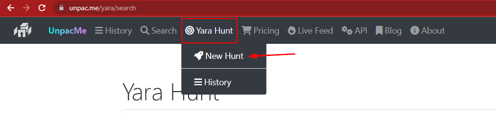
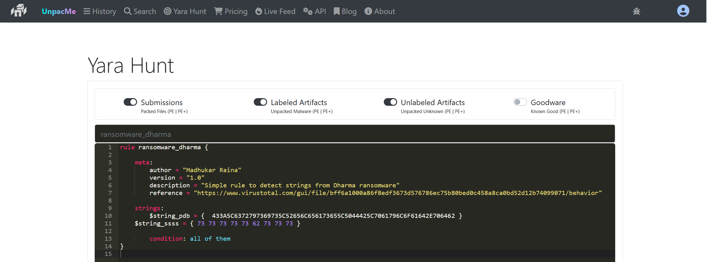
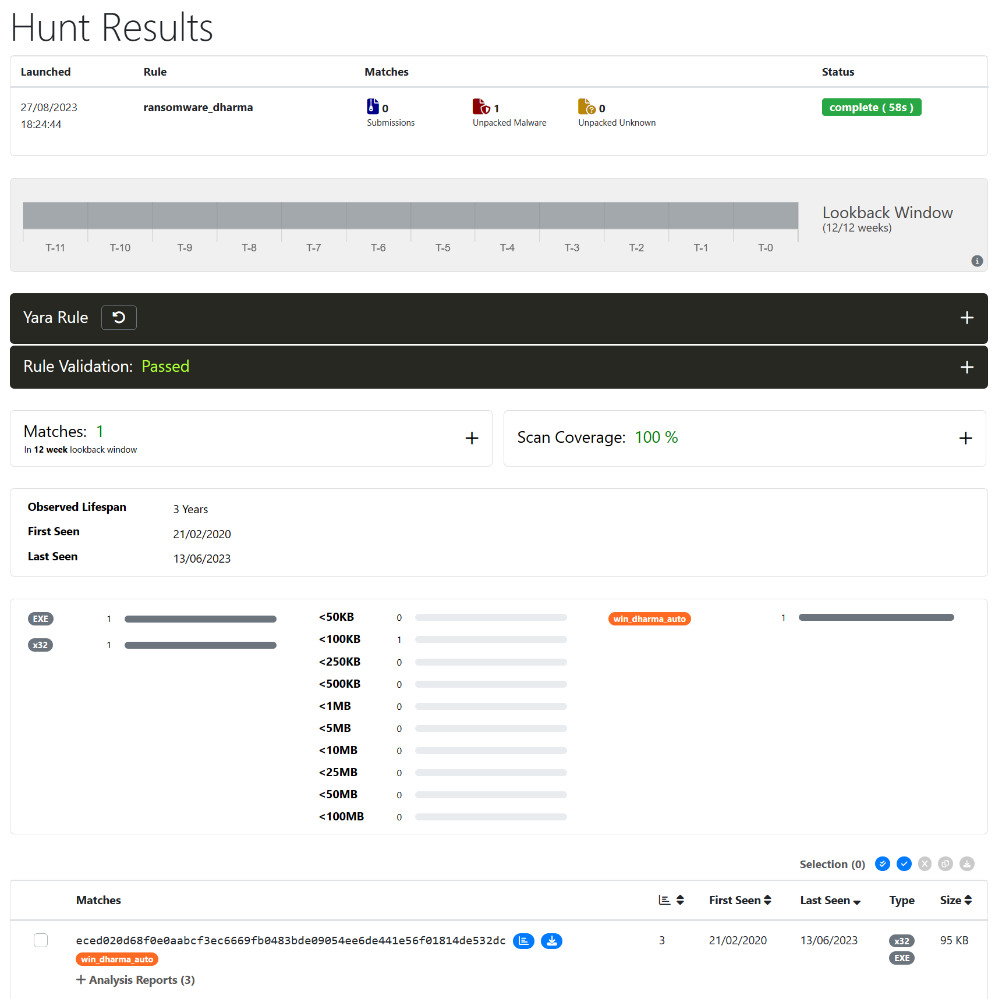

# Hunting Evil with YARA (Web Edition)

[Unpac.Me](https://unpac.me) là công cụ chuyên dùng để unpack (giải nén/bóc vỏ) malware. Điểm tuyệt vời của `Unpac.Me` là nó cho phép ta chạy rule YARA của mình trên cơ sở dữ liệu các mẫu malware được gửi lên mà họ đã tích luỹ. Xét tới những khó khăn khi tiếp cận các bộ dữ liệu malware thương mại, Unpac.Me nổi lên như một tài nguyên hàng đầu cho các SOC analyst tận tuỵ và những người đam mê malware bền bỉ.

## Săn lùng mối đe doạ trong các bộ dữ liệu trực tuyến bằng YARA

Giả sử ta muốn thử nghiệm rule YARA sau.

```yara
rule ransomware_dharma {

    meta:
        author = "Madhukar Raina"
        version = "1.0"
        description = "Simple rule to detect strings from Dharma ransomware"
        reference = "https://www.virustotal.com/gui/file/bff6a1000a86f8edf3673d576786ec75b80bed0c458a8ca0bd52d12b74099071/behavior" 
    
    strings:
        $string_pdb = {  433A5C6372797369735C52656C656173655C5044425C7061796C6F61642E706462 }
	$string_ssss = { 73 73 73 73 73 62 73 73 73 }

        condition: all of them
}
```

Vậy, ta bắt đầu như thế nào?

- Đăng ký tài khoản miễn phí và vào nền tảng.
- Vào mục `Yara Hunt` và chọn `New Hunt`.
	
- Nhập rule YARA vào khung nhập rule được chỉ định.
	
- Trước tiên bấm `Validate` rồi bấm `Scan`.
	
- Kết quả quét được hiển thị ngay trước mắt ta. Nhìn nhanh vào ví dụ của chúng ta, hệ thống đã lướt qua toàn bộ các mẫu malware được gửi lên chỉ trong vài phút và phát hiện 1 kết quả khớp.

	

Với những cá nhân và tổ chức có nguồn lực hạn chế, Unpac.Me và các nền tảng tương tự có thể là bàn đạp để nâng cao năng lực phân tích và phát hiện malware, giúp họ có những đóng góp ý nghĩa cho lĩnh vực an ninh mạng.
