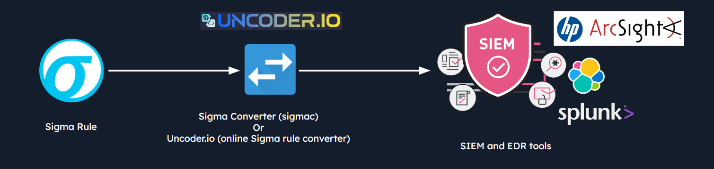
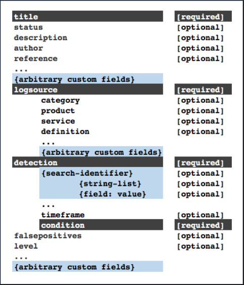
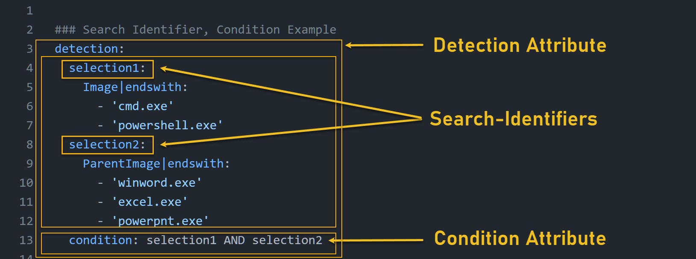
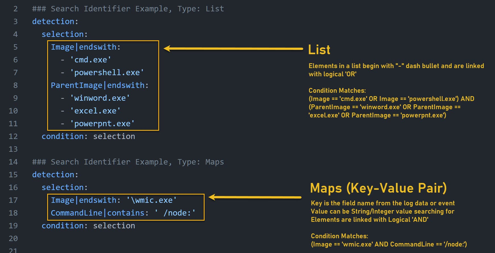

# Sigma and Sigma Rules (Sigma và Sigma rule)

`Sigma` là một định dạng signature chung (generic) dùng để mô tả các detection rule (rule phát hiện) cho việc phân tích log và các hệ thống SIEM. Nó cho phép SOC analyst tạo và chia sẻ các rule giúp nhận diện những pattern (mẫu) hoặc hành vi cụ thể cho thấy mối đe doạ bảo mật hoặc hoạt động độc hại. Sigma rule thường được viết bằng định dạng YAML và có thể dùng với nhiều công cụ và nền tảng bảo mật khác nhau.

SOC analyst dùng Sigma rule để định nghĩa và phát hiện các security event bằng cách phân tích dữ liệu log do nhiều hệ thống sinh ra, như firewall, hệ thống phát hiện xâm nhập (intrusion detection system) và các giải pháp bảo vệ endpoint. Các rule này có thể được tuỳ chỉnh để khớp với từng use case cụ thể và có thể chứa condition, filter cùng các tham số khác để xác định khi nào một event cần kích hoạt alert.

Ưu điểm chính của Sigma rule là tính khả chuyển (portability) và khả năng tương thích với nhiều hệ thống SIEM và phân tích log, cho phép analyst viết rule một lần rồi dùng trên nhiều nền tảng khác nhau.

Có thể xem Sigma là một định dạng chuẩn hoá để analyst tạo và chia sẻ detection rule. Nó giúp chuyển các IOC thành query và có thể dễ dàng tích hợp với các công cụ bảo mật, bao gồm SIEM và EDR. Sigma rule có thể dùng để phát hiện hoạt động đáng ngờ trong nhiều nguồn log khác nhau. Điều này cũng giúp xây dựng các quy trình hiệu quả cho Detection as Code bằng cách tự động hoá việc tạo và triển khai detection rule.



#### Công dụng của Sigma

- **`Universal Log Analytics Tool`** (công cụ phân tích log đa nền tảng): Ta có thể viết detection rule một lần rồi chuyển đổi sang định dạng của nhiều SIEM và công cụ phân tích log khác nhau, khỏi phải lặp đi lặp lại việc viết lại logic trên từng nền tảng.
- **`Community-driven Rule Sharing`** (chia sẻ rule dựa vào cộng đồng): Với Sigma, ta có thể tận dụng một cộng đồng thường xuyên đóng góp và chia sẻ detection rule của họ. Điều này giúp ta liên tục cập nhật và tinh chỉnh các cơ chế phát hiện của mình.
- **`Incident Response`** (ứng phó sự cố): Sigma hỗ trợ incident response bằng cách giúp analyst nhanh chóng tìm kiếm và phân tích log để tìm các pattern hoặc indicator cụ thể.
- **`Proactive Threat Hunting`** (threat hunting chủ động): Ta có thể dùng Sigma rule cho các phiên threat hunting chủ động. Bằng cách tận dụng các pattern cụ thể, ta có thể rà soát các tập dữ liệu để chỉ ra những bất thường (anomaly) hoặc dấu hiệu hoạt động của kẻ tấn công.
- **`Seamless Integration with Automation Tools`** (tích hợp liền mạch với công cụ tự động hoá): Bằng cách chuyển Sigma rule sang định dạng phù hợp, ta có thể tích hợp chúng liền mạch với các nền tảng SOAR và các công cụ tự động hoá khác, cho phép phản ứng tự động dựa trên các phát hiện cụ thể.
- **`Customization for Specific Environments`** (tuỳ biến cho từng môi trường): Sự linh hoạt của Sigma rule cho phép ta điều chỉnh chúng theo những đặc điểm riêng của môi trường mình. Các rule tuỳ chỉnh có thể xử lý những mối đe doạ hoặc kịch bản cụ thể mà ta quan tâm.
- **`Gap Identification`** (xác định khoảng trống): Bằng cách đối chiếu bộ rule của mình với cộng đồng rộng lớn hơn, ta có thể thực hiện gap analysis (phân tích khoảng trống), xác định những chỗ mà năng lực phát hiện của ta có thể cần được tăng cường.

## Sigma hoạt động như thế nào?

Về cốt lõi, Sigma là việc biểu diễn các pattern tìm thấy trong log event theo một cách có cấu trúc. Vì vậy, thay vì có đủ kiểu mô tả rule nằm rải rác trong nhiều định dạng độc quyền (proprietary) khác nhau, với Sigma ta có một chuẩn mở, thống nhất. Định dạng thống nhất này trở thành "ngôn ngữ chung" (lingua franca) cho việc phát hiện mối đe doạ dựa trên log.

Sigma rule được viết bằng YAML. Mỗi Sigma rule mô tả một pattern cụ thể của các log event có thể liên quan tới hoạt động độc hại. Rule bao gồm tiêu đề (title), mô tả (description), nguồn log (log source) và chính pattern đó.

Nhưng điều kỳ diệu nằm ở đây. Sức mạnh thật sự của Sigma nằm ở khả năng chuyển đổi. Có thể ta sẽ hỏi: "Nếu đây là một định dạng chuẩn, làm sao dùng nó với các công cụ và nền tảng logging cụ thể của mình?" Đó là lúc Sigma converter (`sigmac`) vào cuộc. Converter này là mắt xích then chốt trong quy trình làm việc của ta, chuyển Sigma rule thành các query hoặc cấu hình tương thích với vô số SIEM, giải pháp quản lý log và các công cụ phân tích bảo mật khác.

Với `sigmac`, ta có thể lấy một rule viết theo định dạng Sigma và dịch nó sang ElasticSearch, QRadar, Splunk và nhiều nền tảng khác gần như ngay lập tức.

**Lưu ý**: [pySigma](https://github.com/SigmaHQ/pySigma) đang ngày càng trở thành lựa chọn hàng đầu cho việc chuyển đổi rule, vì `sigmac` hiện đã bị coi là lỗi thời (obsolete).

## Cấu trúc Sigma rule

Như đã đề cập, file Sigma rule được viết bằng định dạng YAML. Dưới đây là cấu trúc của một Sigma rule.



**Nguồn**: [https://github.com/SigmaHQ/sigma/wiki/Specification](https://github.com/SigmaHQ/sigma/wiki/Specification)

Hãy cùng tìm hiểu cấu trúc của một Sigma rule qua một ví dụ.

```yaml
title: Potential LethalHTA Technique Execution 
id: ed5d72a6-f8f4-479d-ba79-02f6a80d7471 
status: test 
description: Detects potential LethalHTA technique where "mshta.exe" is spawned by an "svchost.exe" process
references:
    - https://codewhitesec.blogspot.com/2018/07/lethalhta.html
author: Markus Neis 
date: 2018/06/07 
tags: 
    - attack.defense_evasion 
    - attack.t1218.005 
logsource: 
    category: process_creation  
    product: windows
detection:
    selection: 
        ParentImage|endswith: '\svchost.exe'
        Image|endswith: '\mshta.exe'
    condition: selection
falsepositives: 
    - Unknown
level: high
```

Ảnh chụp màn hình dưới đây cho thấy các thành phần tạo nên một Sigma rule:


**Phân tích Sigma rule** (dựa trên [đặc tả của Sigma](https://github.com/SigmaHQ/sigma-specification/blob/main/specification/sigma-rules-specification.md)):

- `title`: Tiêu đề ngắn gọn của rule, nên nêu rõ rule dùng để phát hiện điều gì (tối đa 256 ký tự)

```yaml
title: Potential LethalHTA Technique Execution
...
```

- `id`: Sigma rule nên được định danh bằng một mã định danh duy nhất toàn cục (globally unique identifier) trong thuộc tính id. Với mục đích này, nên dùng [UUID sinh ngẫu nhiên (version 4)](https://www.uuidgenerator.net/version4) nhưng không bắt buộc.

```yaml
title: Potential LethalHTA Technique Execution
id: ed5d72a6-f8f4-479d-ba79-02f6a80d7471
...
```

- `status` (tuỳ chọn): Khai báo trạng thái của rule.
	- `stable`: Rule không tạo ra false positive rõ ràng nào trong nhiều môi trường suốt một thời gian dài
	- `test`: Rule không cho thấy false positive rõ ràng nào trên một tập giới hạn các hệ thống thử nghiệm
	- `experimental`: Rule mới, chưa được kiểm thử bên ngoài môi trường lab và có thể dẫn tới nhiều false positive
	- `deprecated`: Rule này dùng để thay thế hoặc bao quát một rule khác. Liên kết giữa các rule được thực hiện qua field related.
	- `unsupported`: Rule không thể dùng ở trạng thái hiện tại (log correlation đặc biệt, field tự chế, v.v.)

```yaml
title: Potential LethalHTA Technique Execution
id: ed5d72a6-f8f4-479d-ba79-02f6a80d7471
status: test
...
```

- `description` (tuỳ chọn): Mô tả ngắn về rule và hoạt động độc hại có thể phát hiện được (tối đa 65,535 ký tự)

```yaml
title: Potential LethalHTA Technique Execution
id: ed5d72a6-f8f4-479d-ba79-02f6a80d7471
status: test
description: Detects potential LethalHTA technique where "mshta.exe" is spawned by an "svchost.exe" process
...
```

- `references` (tuỳ chọn): Trích dẫn tới nguồn gốc đã truyền cảm hứng cho rule. Có thể bao gồm bài blog, bài báo học thuật, bài thuyết trình hoặc thậm chí là tweet.

```yaml
title: Potential LethalHTA Technique Execution
id: ed5d72a6-f8f4-479d-ba79-02f6a80d7471
status: test
description: Detects potential LethalHTA technique where "mshta.exe" is spawned by an "svchost.exe" process
references:
    - https://codewhitesec.blogspot.com/2018/07/lethalhta.html
...
```

- `author` (tuỳ chọn): Người tạo rule (có thể là tên, nickname, twitter handle, v.v.).

```yaml
title: Potential LethalHTA Technique Execution
id: ed5d72a6-f8f4-479d-ba79-02f6a80d7471
status: test
description: Detects potential LethalHTA technique where "mshta.exe" is spawned by an "svchost.exe" process
references:
    - https://codewhitesec.blogspot.com/2018/07/lethalhta.html
author: Markus Neis
...
```
	
- `date` (tuỳ chọn): Ngày tạo rule. Dùng định dạng `YYYY/MM/DD`.

```yaml
title: Potential LethalHTA Technique Execution
id: ed5d72a6-f8f4-479d-ba79-02f6a80d7471
status: test
description: Detects potential LethalHTA technique where "mshta.exe" is spawned by an "svchost.exe" process
references:
    - https://codewhitesec.blogspot.com/2018/07/lethalhta.html
author: Markus Neis
date: 2018/06/07
...
```

- `logsource`: Phần này mô tả dữ liệu log mà detection sẽ được áp dụng lên. Nó mô tả nguồn log, nền tảng, ứng dụng và loại log cần thiết cho detection. Xem thêm thông tin tại link sau: [https://github.com/SigmaHQ/sigma/tree/master/documentation/logsource-guides](https://github.com/SigmaHQ/sigma/tree/master/documentation/logsource-guides)

	Nó gồm ba thuộc tính được các converter đánh giá tự động và một số lượng tuỳ ý các phần tử tuỳ chọn. Nên dùng một giá trị "definition" khi cần giải thích thêm.
	
	- `category`: Giá trị `category` dùng để chọn tất cả các file log được ghi bởi một nhóm sản phẩm nhất định, như firewall hoặc log web server. Converter tự động sẽ dùng từ khoá này làm bộ chọn (selector) cho nhiều index. Ví dụ: `firewall`, `web`, `antivirus`, v.v.
	- `product`: Giá trị `product` dùng để chọn tất cả log output của một sản phẩm nhất định, vd: mọi loại Windows event log bao gồm `Security`, `System`, `Application` và các loại mới hơn như `AppLocker` và `Windows Defender`. Ví dụ: `windows`, `apache`, `check point fw1`, v.v.
	- `service`: Giá trị `service` dùng để chỉ chọn một tập con trong log của một sản phẩm, như `sshd` trên Linux hoặc event log `Security` trên hệ thống Windows. Ví dụ: `sshd`, `applocker`, v.v.

```yaml
title: Potential LethalHTA Technique Execution
id: ed5d72a6-f8f4-479d-ba79-02f6a80d7471
status: test
description: Detects potential LethalHTA technique where "mshta.exe" is spawned by an "svchost.exe" process
references:
    - https://codewhitesec.blogspot.com/2018/07/lethalhta.html
author: Markus Neis
date: 2018/06/07
logsource:
	category: process_creation
	product: windows
...
```

- `detection`: Một tập các search-identifier (định danh tìm kiếm) biểu diễn thuộc tính của các lượt tìm kiếm trên dữ liệu log. Detection gồm hai thành phần:
	- Search Identifiers
	- Condition
	
	
	
	**Nguồn**: [blusapphire.io](https://docs.blusapphire.io/sigma-rules/sigma-detection-attributes)

```yaml
title: Potential LethalHTA Technique Execution
id: ed5d72a6-f8f4-479d-ba79-02f6a80d7471
status: test
description: Detects potential LethalHTA technique where "mshta.exe" is spawned by an "svchost.exe" process
references:
    - https://codewhitesec.blogspot.com/2018/07/lethalhta.html
author: Markus Neis
date: 2018/06/07
logsource:
	category: process_creation
	product: windows
detection:
	selection:
		ParentImage|endswith: '\svchost.exe'
        Image|endswith: '\mshta.exe'
    condition: selection
...
```

---

Các giá trị trong Sigma rule có thể được thay đổi bằng value modifier. Value modifier được nối sau tên field với ký tự pipe (`|`) làm dấu phân cách và cũng có thể xâu chuỗi (chain) với nhau, vd: `fieldname|mod1|mod2: value`. Các value modifier được áp dụng lên giá trị theo đúng thứ tự đã cho.

Hành vi của search identifier được thay đổi bởi value modifier như trong bảng dưới đây:

|Value Modifier|Giải thích|Ví dụ|
|---|---|---|
| contains|Thêm ký tự wildcard (`*`) bao quanh (các) giá trị | CommandLine\|contains|
| all | Liên kết mọi phần tử của một list bằng logic "AND" (thay vì "OR" mặc định) | CommandLine\|contains\|all|
| startswith | Thêm một ký tự wildcard (`*`) vào cuối giá trị của field  | ParentImage\|startswith |
| endswith | Thêm một ký tự wildcard (`*`) vào đầu giá trị của field | Image\|endswith |
| re: | Giá trị này được các backend xử lý như một regular expression | CommandLine\|re: '\\[String\\]\s*\\$VerbosePreference|

**Nguồn**: [blusapphire.io](https://docs.blusapphire.io/sigma-rules/sigma-detection-attributes)

Search identifier chứa nhiều giá trị trong hai cấu trúc dữ liệu khác nhau:
1. `Lists`, có thể chứa:
	- `strings` được áp dụng lên toàn bộ log message và được liên kết bằng logic `OR`.
	- `maps` (xem bên dưới). Mọi phần tử map của một list được liên kết bằng logic `OR`.
	
	
	
	**Nguồn**: [blusapphire.io](https://docs.blusapphire.io/sigma-rules/sigma-detection-attributes)
	
Ví dụ một list các string khớp với `evilservice` hoặc `svchost.exe -n evil`.
	
```yaml
detection:
 	keywords:
		- evilservice
 		- svchost.exe -n evil
```
		
Ví dụ một list các map khớp với file image `example.exe` hoặc với một file thực thi có description chứa chuỗi `Test executable`.
	
```yaml
detection:
	selection:
 		- Image|endswith: '\example.exe'
		- Description|contains: 'Test executable'
```
	
2. `Maps`: Map (hay dictionary) gồm các cặp key/value, trong đó key là một field trong dữ liệu log và value là một giá trị string hoặc integer. Mọi phần tử của một map được nối với nhau bằng logic `AND`.
	
Ví dụ khớp với event log `Security` và (`Event ID 517` hoặc `Event ID 1102`)
	
```yaml
detection:
    selection:
  	    EventLog: Security
  	    EventID:
  	      - 517
     	  - 1102
	condition: selection
```

Ví dụ khớp với event log `Security` và `Event ID 4679` và `TicketOptions 0x40810000` và `TicketEncryption 0x17`.
	
```yaml
detection:
	selection:
		EventLog: Security
		EventID: 4769
		TicketOptions: '0x40810000'
		TicketEncryption: '0x17'
	condition: selection	
```

- `Condition`: Condition định nghĩa cách các field liên hệ với nhau. Nếu có gì cần lọc, có thể định nghĩa nó trong condition. Condition dùng nhiều operator khác nhau để định nghĩa quan hệ giữa nhiều field, được giải thích dưới đây.

|Operator|Ví dụ|
|---|---|
|Logic AND/OR | `keywords1 or keywords2`|
|1/all of them| ` all of them`|
|1/all of search-identifier-pattern| `all of selection*`|
|1/all of search-id-pattern | `all of filter_*`|
|Phủ định bằng 'not' | `keywords and not filters`|
|Dấu ngoặc - Thứ tự thực hiện '()'| `selection1 and (keywords1 or keywords2)`|

**Nguồn**: [blusapphire.io](https://docs.blusapphire.io/sigma-rules/sigma-detection-attributes)

Ví dụ về một condition:

```yaml 
condition: selection1 or selection2 or selection3
```

---

## Best practice khi phát triển Sigma rule

[Repository đặc tả của Sigma](http://github.com/SigmaHQ/sigma-specification/tree/main) chứa mọi thứ bạn có thể cần về Sigma rule.

Các best practice khi phát triển Sigma rule và những lỗi thường gặp (pitfall) có thể tìm thấy trong [Sigma's Rule Creation Guide](https://github.com/SigmaHQ/sigma/wiki/Rule-Creation-Guide).
