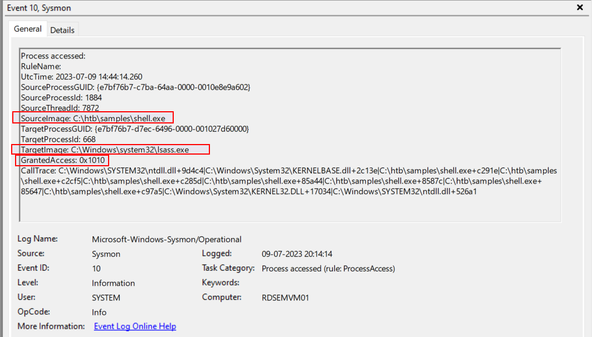
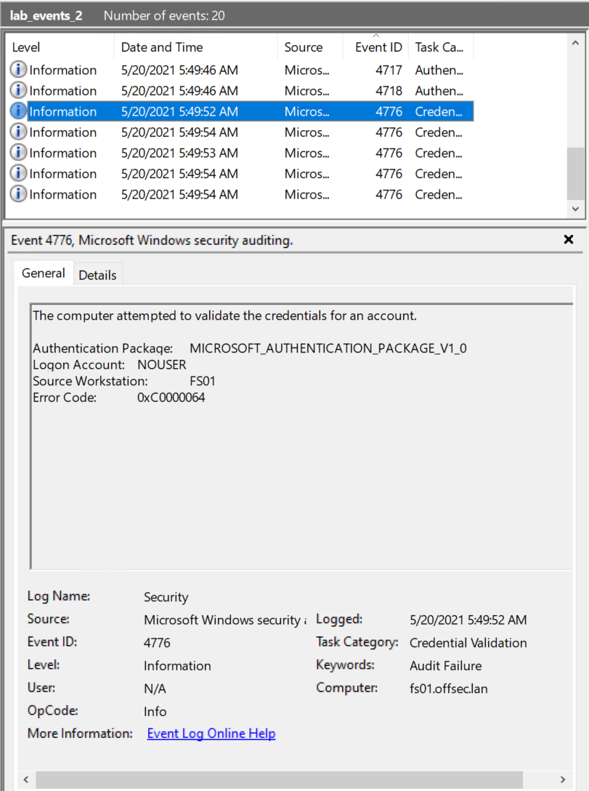
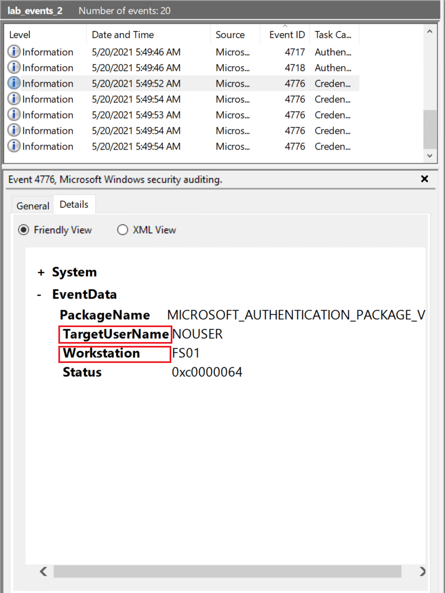

# Developing Sigma Rules (Phát triển Sigma rule)

Trong section này, ta sẽ tìm hiểu cách phát triển Sigma rule thủ công.

<div class="card bg-light">
    <div class="card-body">
				 <p class="mb-0">Bây giờ hãy kéo xuống cuối section này và bấm vào "Click here to spawn the target system!". Sau đó, RDP vào Target IP bằng thông tin đăng nhập được cung cấp. Phần lớn các thao tác/lệnh được trình bày từ đây tới cuối section này đều có thể làm lại trên target, giúp ta nắm các chủ đề được trình bày một cách toàn diện hơn. </p>
    </div>
</div>

## Phát triển Sigma rule thủ công

#### Ví dụ 1: LSASS Credential Dumping

Hãy cùng bước vào thế giới Sigma rule, lấy ví dụ minh hoạ là một sample tên `shell.exe` (một bản đổi tên của [mimikatz](https://en.wikipedia.org/wiki/Mimikatz)) nằm trong thư mục `C:\Samples\YARASigma` trên target của section này. Ta muốn hiểu quy trình xây dựng một Sigma rule, vậy hãy bắt tay vào thực hành.

Sau khi chạy `shell.exe` như dưới đây, ta đã thu thập các event quan trọng nhất và lưu chúng thành `lab_events.evtx` trong thư mục `C:\Events\YARASigma` trên target của section này.

Process do `shell.exe` (mimikatz) tạo ra sẽ cố truy cập bộ nhớ process của `lsass.exe`. Công cụ giám sát hệ thống [Sysmon](https://learn.microsoft.com/en-us/sysinternals/downloads/sysmon) đang chạy ngầm và đã ghi lại hoạt động này trong event log (Event ID [10](https://learn.microsoft.com/en-us/sysinternals/downloads/sysmon#event-id-10-processaccess)).

```shell-session
C:\Samples\YARASigma>shell.exe

  .#####.   mimikatz 2.2.0 (x64) #19041 Sep 19 2022 17:44:08
 .## ^ ##.  "A La Vie, A L'Amour" - (oe.eo)
 ## / \ ##  /*** Benjamin DELPY `gentilkiwi` ( benjamin@gentilkiwi.com )
 ## \ / ##       > https://blog.gentilkiwi.com/mimikatz
 '## v ##'       Vincent LE TOUX             ( vincent.letoux@gmail.com )
  '#####'        > https://pingcastle.com / https://mysmartlogon.com ***/

mimikatz # privilege::debug
Privilege '20' OK

mimikatz # sekurlsa::logonpasswords
---SNIP---
Authentication Id : 0 ; 100080 (00000000:000186f0)
Session           : Interactive from 1
User Name         : htb-student
Domain            : DESKTOP-VJF8GH8
Logon Server      : DESKTOP-VJF8GH8
Logon Time        : 8/25/2023 2:17:20 PM
SID               : S-1-5-21-1412399592-1502967738-1150298762-1001
        msv :
         [00000003] Primary
         * Username : htb-student
         * Domain   : .
         * NTLM     : 3c0e5d303ec84884ad5c3b7876a06ea6
         * SHA1     : b2978f9abc2f356e45cb66ec39510b1ccca08a0e
        tspkg :
        wdigest :
         * Username : htb-student
         * Domain   : DESKTOP-VJF8GH8
         * Password : (null)
        kerberos :
         * Username : htb-student
         * Domain   : DESKTOP-VJF8GH8
         * Password : (null)
        ssp :
        credman :
        cloudap :

Authentication Id : 0 ; 100004 (00000000:000186a4)
Session           : Interactive from 1
User Name         : htb-student
Domain            : DESKTOP-VJF8GH8
Logon Server      : DESKTOP-VJF8GH8
Logon Time        : 8/25/2023 2:17:20 PM
SID               : S-1-5-21-1412399592-1502967738-1150298762-1001
        msv :
         [00000003] Primary
         * Username : htb-student
         * Domain   : .
         * NTLM     : 3c0e5d303ec84884ad5c3b7876a06ea6
         * SHA1     : b2978f9abc2f356e45cb66ec39510b1ccca08a0e
        tspkg :
        wdigest :
         * Username : htb-student
         * Domain   : DESKTOP-VJF8GH8
         * Password : (null)
        kerberos :
         * Username : htb-student
         * Domain   : DESKTOP-VJF8GH8
         * Password : HTB_@cademy_stdnt!
        ssp :
        credman :
        cloudap :
---SNIP---
```

Trước hết, Sysmon `Event ID 10` được kích hoạt khi một process truy cập một process khác, và nó ghi lại các permission flag (cờ quyền) trong field `GrantedAccess`. Event log này chứa hai field quan trọng là `TargetImage` và `GrantedAccess`. Trong một kịch bản dump bộ nhớ LSASS điển hình, process độc hại cần có những quyền cụ thể để truy cập vùng nhớ của process LSASS. Các quyền này thường là quyền đọc/ghi, cùng một số quyền khác.



Vậy tại sao `0x1010` lại quan trọng ở đây? Flag dạng hex này về cơ bản là sự kết hợp của hai quyền `PROCESS_VM_READ (0x0010)` và `PROCESS_QUERY_INFORMATION (0x0400)`. Nói cách khác: process đang yêu cầu quyền đọc bộ nhớ ảo (virtual memory) của LSASS và khả năng truy vấn một số thông tin từ process. Trong khi `0x0410` là flag GrantedAccess phổ biến nhất được dùng để đọc bộ nhớ LSASS, thì `0x1010` hàm ý cả việc đọc lẫn truy vấn thông tin từ process và cũng thường được quan sát thấy trong các cuộc tấn công credential dumping.

Vậy làm sao để "vũ khí hoá" thông tin này cho việc phát hiện? Trong hệ thống giám sát bảo mật (security monitoring stack) của mình, ta sẽ cấu hình Sysmon để gắn cờ hoặc tạo alert cho mọi `Event ID 10` có `TargetImage` là `lsass.exe` và `GrantedAccess` được đặt là `0x1010`.

Một Sigma rule kiểm tra các điều kiện nêu trên được trình bày dưới đây.

```yaml
title: LSASS Access with rare GrantedAccess flag 
status: experimental
description: This rule will detect when a process tries to access LSASS memory with suspicious access flag 0x1010
date: 2023/07/08
tags:
    - attack.credential_access
    - attack.t1003.001
logsource:
    category: process_access
    product: windows
detection:
    selection:
        TargetImage|endswith: '\lsass.exe'
        GrantedAccess|endswith: '0x1010'
    condition: selection
```

**Phân tích Sigma rule**

- `title`: Tiêu đề này mô tả ngắn gọn mục tiêu của rule, cụ thể là nhằm phát hiện các tương tác với bộ nhớ LSASS có liên quan tới một access flag cụ thể.
```yaml
title: LSASS Access with rare GrantedAccess flag
```
- `status`: Field này cho biết rule đang ở giai đoạn thử nghiệm, ngụ ý rằng có thể cần tinh chỉnh hoặc kiểm chứng thêm.
```yaml
status: experimental
```
- `description`: Mô tả rule.
```yaml
description: This rule will detect when a process tries to access LSASS memory with suspicious access flag 0x1010
```
- `date`: Field này đánh dấu ngày rule được cập nhật hoặc được tạo ban đầu.
```yaml
date: 2023/07/08
```
- `tags`: Rule được gắn tag `attack.credential_access` và `attack.t1003.001`. Các tag này giúp phân loại rule dựa trên các technique hoặc tactic tấn công đã biết liên quan tới credential access.
```yaml
tags:
	- attack.credential_access
	- attack.t1003.001`
```
- `logsource`: Logsource chỉ định nguồn log mà rule sẽ phân tích. Nó có `category` là `process_access`, cho biết rule tập trung vào các log event liên quan tới việc truy cập process (`Sysmon Event ID 10`, nếu ta dùng các file config mặc định của Sigma). Ngoài ra, `product: windows` chỉ định rằng rule được thiết kế riêng cho hệ điều hành Windows.
```yaml
logsource:
	category: process_access
	product: windows
```
- `detection`: Phần detection định nghĩa các điều kiện phải được thoả mãn để rule kích hoạt alert. Phần selection chỉ định tiêu chí để chọn các log event liên quan, trong đó field `TargetImage` kết thúc bằng `\lsass.exe` và field `GrantedAccess` kết thúc bằng giá trị hex `0x1010`. Field `GrantedAccess` biểu thị các quyền truy cập (access rights hay permissions) gắn với process. Trong trường hợp này, nó nhắm tới các event có access flag cụ thể là `0x1010`. Cuối cùng, phần condition chỉ định rằng tiêu chí selection phải được thoả mãn thì rule mới kích hoạt alert. Ở đây, cả hai tiêu chí `TargetImage` và `GrantedAccess` đều phải được thoả mãn.
```yaml
detection:
	selection:
        TargetImage|endswith: '\lsass.exe'
        GrantedAccess|endswith: '0x1010'
    condition: selection
```

---

Sigma rule đầu tiên của ta ở trên có thể tìm thấy trong thư mục `C:\Rules\sigma` trên target của section này với tên `proc_access_win_lsass_access.yml`. Hãy cùng khám phá công cụ `sigmac` — công cụ có thể giúp ta chuyển rule này thành các query hoặc cấu hình tương thích với vô số SIEM, giải pháp quản lý log và các công cụ phân tích bảo mật khác.

Công cụ `sigmac` nằm trong thư mục `C:\Tools\sigma-0.21\tools` trên target của section này.

Giả sử ta muốn chuyển Sigma rule của mình thành một query PowerShell (`Get-WinEvent`). Việc này có thể thực hiện với sự trợ giúp của `sigmac` như sau.

```powershell-session
PS C:\Tools\sigma-0.21\tools> python sigmac -t powershell 'C:\Rules\sigma\proc_access_win_lsass_access.yml'
Get-WinEvent | where {($_.ID -eq "10" -and $_.message -match "TargetImage.*.*\\lsass.exe" -and $_.message -match "GrantedAccess.*.*0x1010") } | select TimeCreated,Id,RecordId,ProcessId,MachineName,Message
```

Hãy điều chỉnh query Get-WinEvent ở trên bằng cách chỉ định file .evtx liên quan tới việc LSASS bị một process khác truy cập (`lab_events.evtx` trong thư mục `C:\Events\YARASigma` trên target của section này) và xem nó có xác định được Sysmon event (`ID 10`) mà ta đã phân tích ở đầu section này hay không.

**Lưu ý**: Hãy mở một terminal PowerShell với quyền administrator để chạy query.

```powershell-session
PS C:\Tools\sigma-0.21\tools> Get-WinEvent -Path C:\Events\YARASigma\lab_events.evtx | where {($_.ID -eq "10" -and $_.message -match "TargetImage.*.*\\lsass.exe" -and $_.message -match "GrantedAccess.*.*0x1010") } | select TimeCreated,Id,RecordId,ProcessId,MachineName,Message


TimeCreated : 7/9/2023 7:44:14 AM
Id          : 10
RecordId    : 7810
ProcessId   : 3324
MachineName : RDSEMVM01
Message     : Process accessed:
              RuleName:
              UtcTime: 2023-07-09 14:44:14.260
              SourceProcessGUID: {e7bf76b7-c7ba-64aa-0000-0010e8e9a602}
              SourceProcessId: 1884
              SourceThreadId: 7872
              SourceImage: C:\htb\samples\shell.exe
              TargetProcessGUID: {e7bf76b7-d7ec-6496-0000-001027d60000}
              TargetProcessId: 668
              TargetImage: C:\Windows\system32\lsass.exe
              GrantedAccess: 0x1010
              CallTrace: C:\Windows\SYSTEM32\ntdll.dll+9d4c4|C:\Windows\System32\KERNELBASE.dll+2c13e|C:\htb\samples\sh
              ell.exe+c291e|C:\htb\samples\shell.exe+c2cf5|C:\htb\samples\shell.exe+c285d|C:\htb\samples\shell.exe+85a4
              4|C:\htb\samples\shell.exe+8587c|C:\htb\samples\shell.exe+85647|C:\htb\samples\shell.exe+c97a5|C:\Windows
              \System32\KERNEL32.DLL+17034|C:\Windows\SYSTEM32\ntdll.dll+526a1
              SourceUser: %12
              TargetUser: %13
```


Sysmon event liên quan có ID 10 đã được xác định thành công!


---

Nhưng đừng dừng lại ở đó - hãy nhớ rằng false positive là kẻ thù của việc giám sát bảo mật hiệu quả.
- Ta cũng nên đối chiếu `SourceImage` (process khởi tạo việc truy cập) với một danh sách các process đã biết là an toàn và thường tương tác với LSASS.
- Nếu ta thấy một process lạ hoặc bất thường cố đọc LSASS với `GrantedAccess` kết thúc bằng `10`, `30`, `50`, `70`, `90`, `B0`, `D0`, `F0`, `18`, `38`, `58`, `78`, `98`, `B8`, `D8`, `F8`, `1A`, `3A`, `5A`, `7A`, `9A`, `BA`, `DA`, `FA`, `0x14C2` và `FF` (các hậu tố này có được từ việc nghiên cứu các giá trị `GrantedAccess` mà nhiều kỹ thuật credential dumping LSASS khác nhau yêu cầu), thì đó là một dấu hiệu báo động (red flag), và quy trình incident response của ta nên được kích hoạt.
- Đặc biệt, nếu `SourceImage` nằm trong các đường dẫn đáng ngờ chứa `\Temp\`, `\Users\Public\`, `\PerfLogs\`, `\AppData\`, `\htb\`, v.v. thì đó là một red flag khác, và quy trình incident response của ta nên được kích hoạt.

Một phiên bản chắc chắn (robust) hơn của Sigma rule ta đã tạo, có tính tới các điểm nêu trên, có thể tìm thấy trong thư mục `C:\Rules\sigma` trên target của section này với tên `proc_access_win_lsass_access_robust.yml`

```yaml
title: LSASS Access From Program in Potentially Suspicious Folder
id: fa34b441-961a-42fa-a100-ecc28c886725
status: experimental
description: Detects process access to LSASS memory with suspicious access flags and from a potentially suspicious folder
references:
    - https://docs.microsoft.com/en-us/windows/win32/procthread/process-security-and-access-rights
    - https://onedrive.live.com/view.aspx?resid=D026B4699190F1E6!2843&ithint=file%2cpptx&app=PowerPoint&authkey=!AMvCRTKB_V1J5ow
    - https://web.archive.org/web/20230208123920/https://cyberwardog.blogspot.com/2017/03/chronicles-of-threat-hunter-hunting-for_22.html
    - https://www.slideshare.net/heirhabarov/hunting-for-credentials-dumping-in-windows-environment
    - http://security-research.dyndns.org/pub/slides/FIRST2017/FIRST-2017_Tom-Ueltschi_Sysmon_FINAL_notes.pdf
author: Florian Roth (Nextron Systems)
date: 2021/11/27
modified: 2023/05/05
tags:
    - attack.credential_access
    - attack.t1003.001
    - attack.s0002
logsource:
    category: process_access
    product: windows
detection:
    selection:
        TargetImage|endswith: '\lsass.exe'
        GrantedAccess|endswith:
            - '10'
            - '30'
            - '50'
            - '70'
            - '90'
            - 'B0'
            - 'D0'
            - 'F0'
            - '18'
            - '38'
            - '58'
            - '78'
            - '98'
            - 'B8'
            - 'D8'
            - 'F8'
            - '1A'
            - '3A'
            - '5A'
            - '7A'
            - '9A'
            - 'BA'
            - 'DA'
            - 'FA'
            - '0x14C2'  # https://github.com/b4rtik/ATPMiniDump/blob/76304f93b390af3bb66e4f451ca16562a479bdc9/ATPMiniDump/ATPMiniDump.c
            - 'FF'
        SourceImage|contains:
            - '\Temp\'
            - '\Users\Public\'
            - '\PerfLogs\'
            - '\AppData\'
            - '\htb\'
    filter_optional_generic_appdata:
        SourceImage|startswith: 'C:\Users\'
        SourceImage|contains: '\AppData\Local\'
        SourceImage|endswith:
            - '\Microsoft VS Code\Code.exe'
            - '\software_reporter_tool.exe'
            - '\DropboxUpdate.exe'
            - '\MBAMInstallerService.exe'
            - '\WebexMTA.exe'
            - '\WebEx\WebexHost.exe'
            - '\JetBrains\Toolbox\bin\jetbrains-toolbox.exe'
        GrantedAccess: '0x410'
    filter_optional_dropbox_1:
        SourceImage|startswith: 'C:\Windows\Temp\'
        SourceImage|endswith: '.tmp\DropboxUpdate.exe'
        GrantedAccess:
            - '0x410'
            - '0x1410'
    filter_optional_dropbox_2:
        SourceImage|startswith: 'C:\Users\'
        SourceImage|contains: '\AppData\Local\Temp\'
        SourceImage|endswith: '.tmp\DropboxUpdate.exe'
        GrantedAccess: '0x1410'
    filter_optional_dropbox_3:
        SourceImage|startswith:
            - 'C:\Program Files (x86)\Dropbox\'
            - 'C:\Program Files\Dropbox\'
        SourceImage|endswith: '\DropboxUpdate.exe'
        GrantedAccess: '0x1410'
    filter_optional_nextron:
        SourceImage|startswith:
            - 'C:\Windows\Temp\asgard2-agent\'
            - 'C:\Windows\Temp\asgard2-agent-sc\'
        SourceImage|endswith:
            - '\thor64.exe'
            - '\thor.exe'
            - '\aurora-agent-64.exe'
            - '\aurora-agent.exe'
        GrantedAccess:
            - '0x1fffff'
            - '0x1010'
            - '0x101010'
    filter_optional_ms_products:
        SourceImage|startswith: 'C:\Users\'
        SourceImage|contains|all:
            - '\AppData\Local\Temp\'
            - '\vs_bootstrapper_'
        GrantedAccess: '0x1410'
    filter_optional_chrome_update:
        SourceImage|startswith: 'C:\Program Files (x86)\Google\Temp\'
        SourceImage|endswith: '.tmp\GoogleUpdate.exe'
        GrantedAccess:
            - '0x410'
            - '0x1410'
    filter_optional_keybase:
        SourceImage|startswith: 'C:\Users\'
        SourceImage|endswith: \AppData\Local\Keybase\keybase.exe
        GrantedAccess: '0x1fffff'
    filter_optional_avira:
        SourceImage|contains: '\AppData\Local\Temp\is-'
        SourceImage|endswith: '.tmp\avira_system_speedup.tmp'
        GrantedAccess: '0x1410'
    filter_optional_viberpc_updater:
        SourceImage|startswith: 'C:\Users\'
        SourceImage|contains: '\AppData\Roaming\ViberPC\'
        SourceImage|endswith: '\updater.exe'
        TargetImage|endswith: '\winlogon.exe'
        GrantedAccess: '0x1fffff'
    filter_optional_adobe_arm_helper:
        SourceImage|startswith:  # Example path: 'C:\Program Files (x86)\Common Files\Adobe\ARM\1.0\Temp\2092867405\AdobeARMHelper.exe'
            - 'C:\Program Files\Common Files\Adobe\ARM\'
            - 'C:\Program Files (x86)\Common Files\Adobe\ARM\'
        SourceImage|endswith: '\AdobeARMHelper.exe'
        GrantedAccess: '0x1410'
    condition: selection and not 1 of filter_optional_*
fields:
    - User
    - SourceImage
    - GrantedAccess
falsepositives:
    - Updaters and installers are typical false positives. Apply custom filters depending on your environment
level: medium
```

Hãy để ý cách condition lọc bỏ false positive (selection `and not 1 of filter_optional_*`).

---

#### Ví dụ 2: Nhiều lần đăng nhập thất bại từ cùng một nguồn (dựa trên Event 4776)

Theo Microsoft, [Event 4776](https://learn.microsoft.com/en-us/windows/security/threat-protection/auditing/event-4776) được sinh ra mỗi khi diễn ra một lần xác thực thông tin đăng nhập (credential validation) bằng NTLM authentication.

Event này chỉ xuất hiện trên máy tính có thẩm quyền (authoritative) đối với thông tin đăng nhập được cung cấp. Với tài khoản domain, domain controller là máy có thẩm quyền. Với tài khoản local, máy tính local là máy có thẩm quyền.

Nó hiển thị cả các lần thử xác thực thông tin đăng nhập thành công lẫn thất bại.

Nó chỉ hiển thị tên máy tính (`Source Workstation`) nơi thực hiện lần thử xác thực (nguồn xác thực). Ví dụ, nếu bạn xác thực từ CLIENT-1 tới SERVER-1 bằng tài khoản domain, bạn sẽ thấy CLIENT-1 trong field `Source Workstation`. Thông tin về máy đích (SERVER-1) không được thể hiện trong event này.

Nếu một lần thử xác thực thông tin đăng nhập thất bại, bạn sẽ thấy một Failure event với tham số Error Code có giá trị khác `0x0`.

`lab_events_2.evtx` trong thư mục `C:\Events\YARASigma` trên target của section này chứa các event liên quan tới nhiều lần đăng nhập thất bại nhắm vào `NOUSER` (cảm ơn [mdecrevoisier](https://twitter.com/mdecrevoisier)).





Một Sigma rule hợp lệ để phát hiện nhiều lần đăng nhập thất bại xuất phát từ cùng một nguồn có thể tìm thấy trong thư mục `C:\Rules\sigma` trên target của section này, được lưu với tên `win_security_susp_failed_logons_single_source2.yml`

```yaml
title: Failed NTLM Logins with Different Accounts from Single Source System
id: 6309ffc4-8fa2-47cf-96b8-a2f72e58e538
related:
    - id: e98374a6-e2d9-4076-9b5c-11bdb2569995
      type: derived
status: unsupported
description: Detects suspicious failed logins with different user accounts from a single source system
author: Florian Roth (Nextron Systems)
date: 2017/01/10
modified: 2023/02/24
tags:
    - attack.persistence
    - attack.privilege_escalation
    - attack.t1078
logsource:
    product: windows
    service: security
detection:
    selection2:
        EventID: 4776
        TargetUserName: '*'
        Workstation: '*'
    condition: selection2 | count(TargetUserName) by Workstation > 3
falsepositives:
    - Terminal servers
    - Jump servers
    - Other multiuser systems like Citrix server farms
    - Workstations with frequently changing users
level: medium
```

**Phân tích Sigma rule**:

- `logsource`: Phần này chỉ định rằng rule dành cho hệ thống Windows (`product: windows`) và chỉ tập trung vào event log `Security` (`service: security`).

```yaml
logsource:
    product: windows
    service: security
```
- `detection`: `selection2` về cơ bản chính là bộ lọc. Nó tìm các log có EventID `4776` (`EventID: 4776`) bất kể giá trị `TargetUserName` hay `Workstation` là gì (`TargetUserName: '*'`, `Workstation: '*'`). `condition` đếm số lần xuất hiện của `TargetUserName` nhóm theo `Workstation` và kiểm tra xem có workstation nào có nhiều hơn `three` lần đăng nhập thất bại hay không.

---

## Tài liệu về phát triển Sigma rule

Như bạn có thể đoán, tài liệu tốt nhất cho việc phát triển Sigma rule là tài liệu chính thức, có thể tìm thấy tại các link sau.
- [https://github.com/SigmaHQ/sigma/wiki/Rule-Creation-Guide](https://github.com/SigmaHQ/sigma/wiki/Rule-Creation-Guide)
- [https://github.com/SigmaHQ/sigma-specification](https://github.com/SigmaHQ/sigma-specification)

Loạt bài viết sau là nguồn tài liệu tốt nhất tiếp theo về phát triển Sigma rule.
- [https://tech-en.netlify.app/articles/en510480/](https://tech-en.netlify.app/articles/en510480/)
- [https://tech-en.netlify.app/articles/en513032/](https://tech-en.netlify.app/articles/en513032/)
- [https://tech-en.netlify.app/articles/en515532/](https://tech-en.netlify.app/articles/en515532/)

---

Trong section tiếp theo, ta sẽ tìm hiểu cách dùng Sigma rule để phân tích event log trên quy mô lớn nhằm nhanh chóng xác định các mối đe doạ.
