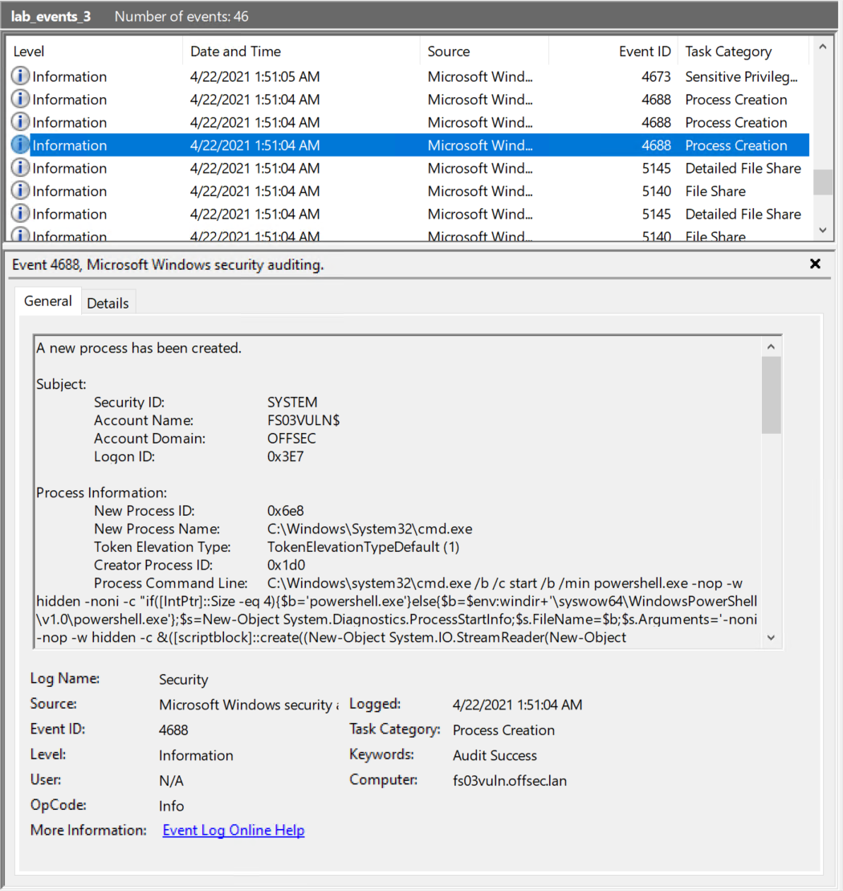

# Hunting Evil with Sigma (Chainsaw Edition)

Trong an ninh mạng, thời gian là yếu tố sống còn. Phân tích nhanh giúp ta không chỉ nhận diện mà còn phản ứng với các mối đe doạ trước khi chúng leo thang.

Khi phải chạy đua với thời gian để mò kim đáy bể giữa hàng đống Windows Event Log mà không có SIEM trong tay, Sigma rule kết hợp với các công cụ như [Chainsaw](https://github.com/WithSecureLabs/chainsaw) và [Zircolite](https://github.com/wagga40/Zircolite) là những trợ thủ đắc lực nhất của ta.

Cả hai công cụ đều cho phép dùng Sigma rule để quét không chỉ một mà nhiều file EVTX cùng lúc, mang lại khả năng quét rộng và toàn diện hơn một cách rất hiệu quả.

<div class="card bg-light">
    <div class="card-body">
				 <p class="mb-0">Bây giờ hãy kéo xuống cuối section này và bấm vào "Click here to spawn the target system!". Sau đó, RDP vào Target IP bằng thông tin đăng nhập được cung cấp. Phần lớn các thao tác/lệnh được trình bày từ đây đến cuối section đều có thể thực hiện lại trên máy target, giúp nắm vững hơn các chủ đề được trình bày.</p>
    </div>
</div>

## Quét Windows Event Log bằng Chainsaw

Chainsaw là công cụ miễn phí, được thiết kế để nhanh chóng xác định các mối đe doạ bảo mật trong Windows Event Log. Công cụ này cho phép tìm kiếm event log theo từ khoá (keyword) một cách hiệu quả, đồng thời được tích hợp sẵn hỗ trợ Sigma detection rule cũng như rule Chainsaw tuỳ chỉnh. Vì vậy, nó là công cụ rất hữu ích để kiểm chứng (validate) Sigma rule của ta bằng cách áp dụng chúng lên event log thực tế.
Hãy tải Chainsaw từ repository Github chính thức và chạy nó với một số Sigma rule:

Chainsaw có sẵn trong thư mục `C:\Tools\chainsaw` trên máy target của section này.

Trước tiên, hãy chạy Chainsaw với cờ `-h` để xem menu trợ giúp.

```powershell-session
PS C:\Tools\chainsaw> .\chainsaw_x86_64-pc-windows-msvc.exe -h
Rapidly work with Forensic Artefacts

Usage: chainsaw_x86_64-pc-windows-msvc.exe [OPTIONS] <COMMAND>

Commands:
  dump     Dump an artefact into a different format
  hunt     Hunt through artefacts using detection rules for threat detection
  lint     Lint provided rules to ensure that they load correctly
  search   Search through forensic artefacts for keywords
  analyse  Perform various analyses on artifacts
  help     Print this message or the help of the given subcommand(s)

Options:
      --no-banner                  Hide Chainsaw's banner
      --num-threads <NUM_THREADS>  Limit the thread number (default: num of CPUs)
  -h, --help                       Print help
  -V, --version                    Print version

Examples:

    Hunt with Sigma and Chainsaw Rules:
        ./chainsaw hunt evtx_attack_samples/ -s sigma/ --mapping mappings/sigma-event-logs-all.yml -r rules/

    Hunt with Sigma rules and output in JSON:
        ./chainsaw hunt evtx_attack_samples/ -s sigma/ --mapping mappings/sigma-event-logs-all.yml --json

    Search for the case-insensitive word 'mimikatz':
        ./chainsaw search mimikatz -i evtx_attack_samples/

    Search for Powershell Script Block Events (EventID 4014):
        ./chainsaw search -t 'Event.System.EventID: =4104' evtx_attack_samples/
```

---

#### Ví dụ 1: Hunting nhiều lần đăng nhập thất bại từ cùng một nguồn bằng Sigma

Hãy cho Chainsaw vào việc bằng cách áp dụng Sigma rule gần đây nhất của ta, `win_security_susp_failed_logons_single_source2.yml` (có tại `C:\Rules\sigma`), lên `lab_events_2.evtx` (có tại `C:\Events\YARASigma\lab_events_2.evtx`) — file này chứa nhiều lần đăng nhập thất bại từ cùng một nguồn.

```powershell-session
PS C:\Tools\chainsaw> .\chainsaw_x86_64-pc-windows-msvc.exe hunt C:\Events\YARASigma\lab_events_2.evtx -s C:\Rules\sigma\win_security_susp_failed_logons_single_source2.yml --mapping .\mappings\sigma-event-logs-all.yml

 ██████╗██╗  ██╗ █████╗ ██╗███╗   ██╗███████╗ █████╗ ██╗    ██╗
██╔════╝██║  ██║██╔══██╗██║████╗  ██║██╔════╝██╔══██╗██║    ██║
██║     ███████║███████║██║██╔██╗ ██║███████╗███████║██║ █╗ ██║
██║     ██╔══██║██╔══██║██║██║╚██╗██║╚════██║██╔══██║██║███╗██║
╚██████╗██║  ██║██║  ██║██║██║ ╚████║███████║██║  ██║╚███╔███╔╝
 ╚═════╝╚═╝  ╚═╝╚═╝  ╚═╝╚═╝╚═╝  ╚═══╝╚══════╝╚═╝  ╚═╝ ╚══╝╚══╝
    By Countercept (@FranticTyping, @AlexKornitzer)

[+] Loading detection rules from: C:\Rules\sigma\win_security_susp_failed_logons_single_source2.yml
[+] Loaded 1 detection rules
[+] Loading forensic artefacts from: C:\Events\YARASigma\lab_events_2.evtx (extensions: .evt, .evtx)
[+] Loaded 1 forensic artefacts (69.6 KB)
[+] Hunting: [========================================] 1/1 -
[+] Group: Sigma
┌─────────────────────┬───────────────────────────┬───────┬────────────────────────────────┬──────────┬───────────┬─────────────────┬────────────────────────────────┐
│      timestamp      │        detections         │ count │     Event.System.Provider      │ Event ID │ Record ID │    Computer     │           Event Data           │
├─────────────────────┼───────────────────────────┼───────┼────────────────────────────────┼──────────┼───────────┼─────────────────┼────────────────────────────────┤
│ 2021-05-20 12:49:52 │ + Failed NTLM Logins with │ 5     │ Microsoft-Windows-Security-Aud │ 4776     │ 1861986   │ fs01.offsec.lan │ PackageName: MICROSOFT_AUTHENT │
│                     │ Different Accounts from   │       │ iting                          │          │           │                 │ ICATION_PACKAGE_V1_0           │
│                     │ Single Source System      │       │                                │          │           │                 │ Status: '0xc0000064'           │
│                     │                           │       │                                │          │           │                 │ TargetUserName: NOUSER         │
│                     │                           │       │                                │          │           │                 │ Workstation: FS01              │
└─────────────────────┴───────────────────────────┴───────┴────────────────────────────────┴──────────┴───────────┴─────────────────┴────────────────────────────────┘

[+] 1 Detections found on 1 documents
PS C:\Tools\chainsaw>
```

Sigma rule của ta đã xác định được nhiều lần đăng nhập thất bại nhắm vào `NOUSER`.

Với tham số `-s`, ta có thể chỉ định một thư mục chứa các Sigma detection rule (hoặc một Sigma detection rule duy nhất) và Chainsaw sẽ tự động load, chuyển đổi rồi chạy các rule này trên các event log được cung cấp. File mapping (chỉ định qua tham số `--mapping`) cho Chainsaw biết nên dùng field nào trong event log để so khớp rule.

---

#### Ví dụ 2: Hunting command line PowerShell có độ dài bất thường bằng Sigma (dựa trên Event ID 4688)

Trước hết, hãy đặt nền tảng bằng việc nhận thức rằng PowerShell, vốn là một ngôn ngữ scripting cực kỳ linh hoạt, là mục tiêu hấp dẫn đối với kẻ tấn công. Việc tích hợp sâu với Windows API và .NET Framework khiến nó trở thành ứng viên lý tưởng cho nhiều hoạt động post-exploitation (hậu khai thác).

Để che giấu hành động của mình, kẻ tấn công dùng nhiều lớp encoding phức tạp hoặc lạm dụng cmdlet cho những mục đích mà chúng vốn không được thiết kế. Điều này dẫn tới các lệnh PowerShell dài bất thường, thường kết hợp Base64 encoding, ghép chuỗi và nhiều biến chứa các mảnh rời rạc của lệnh.

Một Sigma rule có thể phát hiện command line PowerShell dài bất thường có sẵn trong thư mục `C:\Rules\sigma` trên máy target của section này, được lưu với tên `proc_creation_win_powershell_abnormal_commandline_size.yml`.

```yaml
title: Unusually Long PowerShell CommandLine
id: d0d28567-4b9a-45e2-8bbc-fb1b66a1f7f6
status: test
description: Detects unusually long PowerShell command lines with a length of 1000 characters or more
references:
    - https://speakerdeck.com/heirhabarov/hunting-for-powershell-abuse
author: oscd.community, Natalia Shornikova / HTB Academy, Dimitrios Bougioukas
date: 2020/10/06
modified: 2023/04/14
tags:
    - attack.execution
    - attack.t1059.001
    - detection.threat_hunting
logsource:
    category: process_creation
    product: windows
detection:
    selection:
        EventID: 4688
        NewProcessName|endswith:
            - '\powershell.exe'
            - '\pwsh.exe'
            - '\cmd.exe'
    selection_powershell:
        CommandLine|contains:
            - 'powershell.exe'
            - 'pwsh.exe'
    selection_length:        
        CommandLine|re: '.{1000,}'
    condition: selection and selection_powershell and selection_length
falsepositives:
    - Unknown
level: low
```

**Phân tích Sigma rule**:

- `logsource`: Rule tìm trong các log thuộc category [process_creation](https://github.com/SigmaHQ/sigma/blob/master/documentation/logsource-guides/windows/category/process_creation.md) và được thiết kế để hoạt động trên máy Windows.
```yaml
logsource:
    category: process_creation
    product: windows
```
- `detection`: Phần `selection` kiểm tra xem có Windows event nào với ID [4688](https://learn.microsoft.com/en-us/windows/security/threat-protection/auditing/event-4688) hay không, đồng thời kiểm tra field `NewProcessName` có kết thúc bằng `\powershell.exe`, `\pwsh.exe` hoặc `\cmd.exe` hay không. Phần `selection_powershell` kiểm tra command line được thực thi có chứa các file thực thi liên quan đến PowerShell hay không, và cuối cùng, phần `selection_length` kiểm tra field `CommandLine` của event `4688` có chứa từ 1.000 ký tự trở lên hay không. Phần `condition` kiểm tra xem các tiêu chí trong các phần `selection`, `selection_powershell` và `selection_length` có đều được thoả mãn hay không.

```yaml
detection:
    selection:
        EventID: 4688
        NewProcessName|endswith:
            - '\powershell.exe'
            - '\pwsh.exe'
            - '\cmd.exe'
    selection_powershell:
        CommandLine|contains:
            - 'powershell.exe'
            - 'pwsh.exe'
    selection_length:        
        CommandLine|re: '.{1000,}'
    condition: selection and selection_powershell and selection_length
```

Hãy cho Chainsaw vào việc bằng cách áp dụng Sigma rule nêu trên, `proc_creation_win_powershell_abnormal_commandline_size.yml` (có tại `C:\Rules\sigma`), lên `lab_events_3.evtx` (có tại `C:\Events\YARASigma\lab_events_3.evtx`, cảm ơn [mdecrevoisier](https://twitter.com/mdecrevoisier)) — file này chứa các event `4688` với các lệnh PowerShell dài bất thường.



```powershell-session
PS C:\Tools\chainsaw> .\chainsaw_x86_64-pc-windows-msvc.exe hunt C:\Events\YARASigma\lab_events_3.evtx -s C:\Rules\sigma\proc_creation_win_powershell_abnormal_commandline_size.yml --mapping .\mappings\sigma-event-logs-all.yml

 ██████╗██╗  ██╗ █████╗ ██╗███╗   ██╗███████╗ █████╗ ██╗    ██╗
██╔════╝██║  ██║██╔══██╗██║████╗  ██║██╔════╝██╔══██╗██║    ██║
██║     ███████║███████║██║██╔██╗ ██║███████╗███████║██║ █╗ ██║
██║     ██╔══██║██╔══██║██║██║╚██╗██║╚════██║██╔══██║██║███╗██║
╚██████╗██║  ██║██║  ██║██║██║ ╚████║███████║██║  ██║╚███╔███╔╝
 ╚═════╝╚═╝  ╚═╝╚═╝  ╚═╝╚═╝╚═╝  ╚═══╝╚══════╝╚═╝  ╚═╝ ╚══╝╚══╝
    By Countercept (@FranticTyping, @AlexKornitzer)

[+] Loading detection rules from: C:\Rules\sigma\proc_creation_win_powershell_abnormal_commandline_size.yml
[+] Loaded 1 detection rules
[+] Loading forensic artefacts from: C:\Events\YARASigma\lab_events_3.evtx (extensions: .evt, .evtx)
[+] Loaded 1 forensic artefacts (69.6 KB)
[+] Hunting: [========================================] 1/1 -
[+] 0 Detections found on 0 documents
```

Sigma rule của ta có vẻ không xác định được các lệnh PowerShell dài bất thường trong các event `4688` này.

Vậy có phải Sigma rule của ta bị sai? Không! Như đã nói ở trên, file mapping của Chainsaw (chỉ định qua tham số `--mapping`) cho nó biết nên dùng field nào trong event log để so khớp rule.

Có vẻ như field `NewProcessName` bị thiếu trong file mapping `sigma-event-logs-all.yml`.

Chúng tôi đã bổ sung field `NewProcessName` vào file mapping `sigma-event-logs-all-new.yml` trong thư mục `C:\Tools\chainsaw\mappings` trên máy target của section này.

Hãy chạy lại Chainsaw với file mapping mới này.

```powershell-session
PS C:\Tools\chainsaw> .\chainsaw_x86_64-pc-windows-msvc.exe hunt C:\Events\YARASigma\lab_events_3.evtx -s C:\Rules\sigma\proc_creation_win_powershell_abnormal_commandline_size.yml --mapping .\mappings\sigma-event-logs-all-new.yml

 ██████╗██╗  ██╗ █████╗ ██╗███╗   ██╗███████╗ █████╗ ██╗    ██╗
██╔════╝██║  ██║██╔══██╗██║████╗  ██║██╔════╝██╔══██╗██║    ██║
██║     ███████║███████║██║██╔██╗ ██║███████╗███████║██║ █╗ ██║
██║     ██╔══██║██╔══██║██║██║╚██╗██║╚════██║██╔══██║██║███╗██║
╚██████╗██║  ██║██║  ██║██║██║ ╚████║███████║██║  ██║╚███╔███╔╝
 ╚═════╝╚═╝  ╚═╝╚═╝  ╚═╝╚═╝╚═╝  ╚═══╝╚══════╝╚═╝  ╚═╝ ╚══╝╚══╝
    By Countercept (@FranticTyping, @AlexKornitzer)

[+] Loading detection rules from: C:\Rules\sigma\proc_creation_win_powershell_abnormal_commandline_size.yml
[+] Loaded 1 detection rules
[+] Loading forensic artefacts from: C:\Events\YARASigma\lab_events_3.evtx (extensions: .evtx, .evt)
[+] Loaded 1 forensic artefacts (69.6 KB)
[+] Hunting: [========================================] 1/1 -
[+] Group: Sigma
┌─────────────────────┬─────────────────────────────┬───────┬────────────────────────────────┬──────────┬───────────┬─────────────────────┬──────────────────────────────────┐
│      timestamp      │         detections          │ count │     Event.System.Provider      │ Event ID │ Record ID │      Computer       │            Event Data            │
├─────────────────────┼─────────────────────────────┼───────┼────────────────────────────────┼──────────┼───────────┼─────────────────────┼──────────────────────────────────┤
│ 2021-04-22 08:51:04 │ + Unusually Long PowerShell │ 1     │ Microsoft-Windows-Security-Aud │ 4688     │ 435121    │ fs03vuln.offsec.lan │ CommandLine: powershell.exe -n   │
│                     │ CommandLine                 │       │ iting                          │          │           │                     │ op -w hidden -noni -c "if([Int   │
│                     │                             │       │                                │          │           │                     │ Ptr]::Size -eq 4){$b='powershe   │
│                     │                             │       │                                │          │           │                     │ ll.exe'}else{$b=$env:windir+'\   │
│                     │                             │       │                                │          │           │                     │ syswow64\WindowsPowerShell\v1.   │
│                     │                             │       │                                │          │           │                     │ 0\powershell.exe'};$s=New-Obje   │
│                     │                             │       │                                │          │           │                     │ ct System.Diagnostics.ProcessS   │
│                     │                             │       │                                │          │           │                     │ tartInfo;$s.FileName=$b;$s.Arg   │
│                     │                             │       │                                │          │           │                     │ uments='-noni -nop -w hidden -   │
│                     │                             │       │                                │          │           │                     │ c &([scriptblock]::create((New   │
│                     │                             │       │                                │          │           │                     │ -Object System.IO.StreamReader   │
│                     │                             │       │                                │          │           │                     │ (New-Object System.IO.Compress   │
│                     │                             │       │                                │          │           │                     │ ion.GzipStream((New-Object Sys   │
│                     │                             │       │                                │          │           │                     │ tem.IO.MemoryStream(,[System.C   │
│                     │                             │       │                                │          │           │                     │ onvert]::FromBase64String(''H4   │
│                     │                             │       │                                │          │           │                     │ sIAPg2gWACA7VWbW+bSBD+nEj5D6iy   │
│                     │                             │       │                                │          │           │                     │ ...                              │
│                     │                             │       │                                │          │           │                     │ (use --full to show all content) │
│                     │                             │       │                                │          │           │                     │ NewProcessId: '0x7f0'            │
│                     │                             │       │                                │          │           │                     │ NewProcessName: C:\Windows\Sys   │
│                     │                             │       │                                │          │           │                     │ tem32\WindowsPowerShell\v1.0\p   │
│                     │                             │       │                                │          │           │                     │ owershell.exe                    │
│                     │                             │       │                                │          │           │                     │ ProcessId: '0x6e8'               │
│                     │                             │       │                                │          │           │                     │ SubjectDomainName: OFFSEC        │
│                     │                             │       │                                │          │           │                     │ SubjectLogonId: '0x3e7'          │
│                     │                             │       │                                │          │           │                     │ SubjectUserName: FS03VULN$       │
│                     │                             │       │                                │          │           │                     │ SubjectUserSid: S-1-5-18         │
│                     │                             │       │                                │          │           │                     │ TokenElevationType: '%%1936'     │
├─────────────────────┼─────────────────────────────┼───────┼────────────────────────────────┼──────────┼───────────┼─────────────────────┼──────────────────────────────────┤
│ 2021-04-22 08:51:04 │ + Unusually Long PowerShell │ 1     │ Microsoft-Windows-Security-Aud │ 4688     │ 435120    │ fs03vuln.offsec.lan │ CommandLine: C:\Windows\system   │
│                     │ CommandLine                 │       │ iting                          │          │           │                     │ 32\cmd.exe /b /c start /b /min   │
│                     │                             │       │                                │          │           │                     │  powershell.exe -nop -w hidden   │
│                     │                             │       │                                │          │           │                     │  -noni -c "if([IntPtr]::Size -   │
│                     │                             │       │                                │          │           │                     │ eq 4){$b='powershell.exe'}else   │
│                     │                             │       │                                │          │           │                     │ {$b=$env:windir+'\syswow64\Win   │
│                     │                             │       │                                │          │           │                     │ dowsPowerShell\v1.0\powershell   │
│                     │                             │       │                                │          │           │                     │ .exe'};$s=New-Object System.Di   │
│                     │                             │       │                                │          │           │                     │ agnostics.ProcessStartInfo;$s.   │
│                     │                             │       │                                │          │           │                     │ FileName=$b;$s.Arguments='-non   │
│                     │                             │       │                                │          │           │                     │ i -nop -w hidden -c &([scriptb   │
│                     │                             │       │                                │          │           │                     │ lock]::create((New-Object Syst   │
│                     │                             │       │                                │          │           │                     │ em.IO.StreamReader(New-Object    │
│                     │                             │       │                                │          │           │                     │ System.IO.Compression.GzipStre   │
│                     │                             │       │                                │          │           │                     │ am((New-Object System.IO.Memor   │
│                     │                             │       │                                │          │           │                     │ yStream(,[System.Convert]::Fro   │
│                     │                             │       │                                │          │           │                     │ ...                              │
│                     │                             │       │                                │          │           │                     │ (use --full to show all content) │
│                     │                             │       │                                │          │           │                     │ NewProcessId: '0x6e8'            │
│                     │                             │       │                                │          │           │                     │ NewProcessName: C:\Windows\Sys   │
│                     │                             │       │                                │          │           │                     │ tem32\cmd.exe                    │
│                     │                             │       │                                │          │           │                     │ ProcessId: '0x1d0'               │
│                     │                             │       │                                │          │           │                     │ SubjectDomainName: OFFSEC        │
│                     │                             │       │                                │          │           │                     │ SubjectLogonId: '0x3e7'          │
│                     │                             │       │                                │          │           │                     │ SubjectUserName: FS03VULN$       │
│                     │                             │       │                                │          │           │                     │ SubjectUserSid: S-1-5-18         │
│                     │                             │       │                                │          │           │                     │ TokenElevationType: '%%1936'     │
├─────────────────────┼─────────────────────────────┼───────┼────────────────────────────────┼──────────┼───────────┼─────────────────────┼──────────────────────────────────┤
│ 2021-04-22 08:51:05 │ + Unusually Long PowerShell │ 1     │ Microsoft-Windows-Security-Aud │ 4688     │ 435124    │ fs03vuln.offsec.lan │ CommandLine: '"C:\Windows\sysw   │
│                     │ CommandLine                 │       │ iting                          │          │           │                     │ ow64\WindowsPowerShell\v1.0\po   │
│                     │                             │       │                                │          │           │                     │ wershell.exe" -noni -nop -w hi   │
│                     │                             │       │                                │          │           │                     │ dden -c &([scriptblock]::creat   │
│                     │                             │       │                                │          │           │                     │ e((New-Object System.IO.Stream   │
│                     │                             │       │                                │          │           │                     │ Reader(New-Object System.IO.Co   │
│                     │                             │       │                                │          │           │                     │ mpression.GzipStream((New-Obje   │
│                     │                             │       │                                │          │           │                     │ ct System.IO.MemoryStream(,[Sy   │
│                     │                             │       │                                │          │           │                     │ stem.Convert]::FromBase64Strin   │
│                     │                             │       │                                │          │           │                     │ g(''H4sIAPg2gWACA7VWbW+bSBD+nE   │
│                     │                             │       │                                │          │           │                     │ j5D6iyBKiOIbbbvEiVbgFju4kdbBI7   │
│                     │                             │       │                                │          │           │                     │ sWud1rCGbRbWgSWO0/a/32CgTa/pXX   │
│                     │                             │       │                                │          │           │                     │ vSIb/sy8zszDPPzrDKYk9QHku+w91M   │
│                     │                             │       │                                │          │           │                     │ +nSwv+fgBEeSUouy9fqkLtXSsaPu7c   │
│                     │                             │       │                                │          │           │                     │ FGjXd7+K30TlLmaL22eIRpvDg7M7Mk   │
│                     │                             │       │                                │          │           │                     │ IbEo5o0uEShNSbRklKSKKn2WpiFJyO   │
│                     │                             │       │                                │          │           │                     │ ...                              │
│                     │                             │       │                                │          │           │                     │ (use --full to show all content) │
│                     │                             │       │                                │          │           │                     │ NewProcessId: '0x8f0'            │
│                     │                             │       │                                │          │           │                     │ NewProcessName: C:\Windows\Sys   │
│                     │                             │       │                                │          │           │                     │ WOW64\WindowsPowerShell\v1.0\p   │
│                     │                             │       │                                │          │           │                     │ owershell.exe                    │
│                     │                             │       │                                │          │           │                     │ ProcessId: '0x7f0'               │
│                     │                             │       │                                │          │           │                     │ SubjectDomainName: OFFSEC        │
│                     │                             │       │                                │          │           │                     │ SubjectLogonId: '0x3e7'          │
│                     │                             │       │                                │          │           │                     │ SubjectUserName: FS03VULN$       │
│                     │                             │       │                                │          │           │                     │ SubjectUserSid: S-1-5-18         │
│                     │                             │       │                                │          │           │                     │ TokenElevationType: '%%1936'     │
└─────────────────────┴─────────────────────────────┴───────┴────────────────────────────────┴──────────┴───────────┴─────────────────────┴──────────────────────────────────┘

[+] 3 Detections found on 3 documents
```

Sigma rule của ta đã phát hiện thành công cả ba lệnh PowerShell dài bất thường có trong `lab_events_3.evtx`

Hãy nhớ rằng cấu hình là yếu tố cực kỳ quan trọng khi sử dụng hoặc chuyển đổi Sigma rule!
